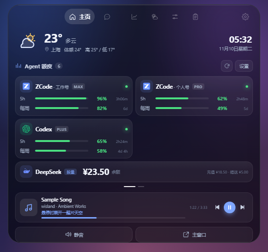
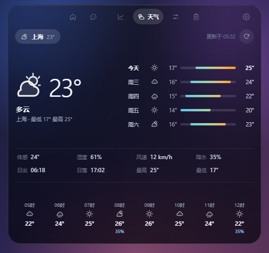
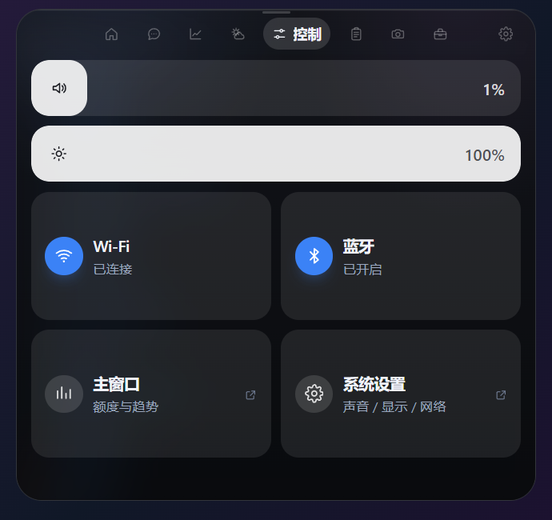
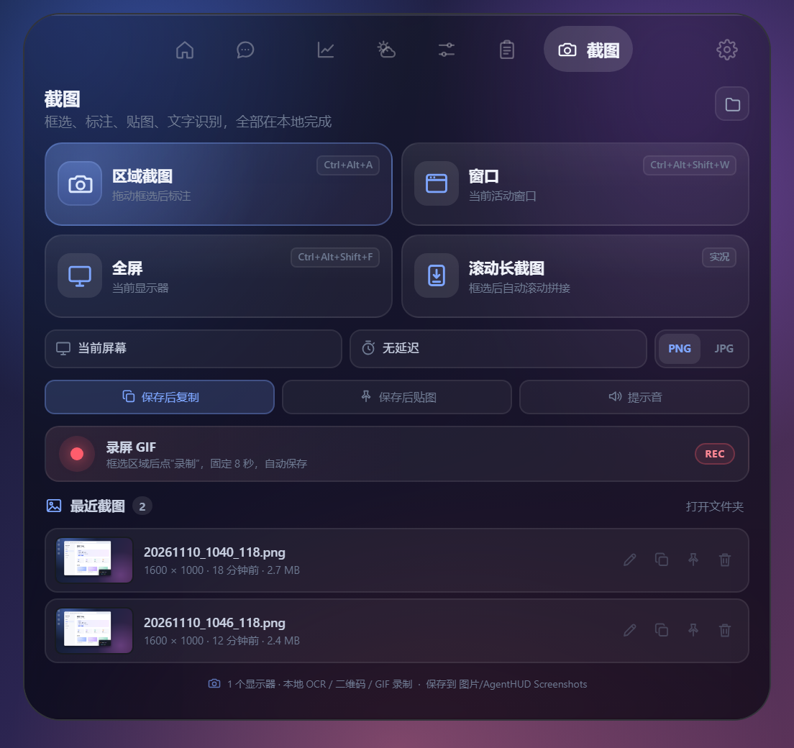
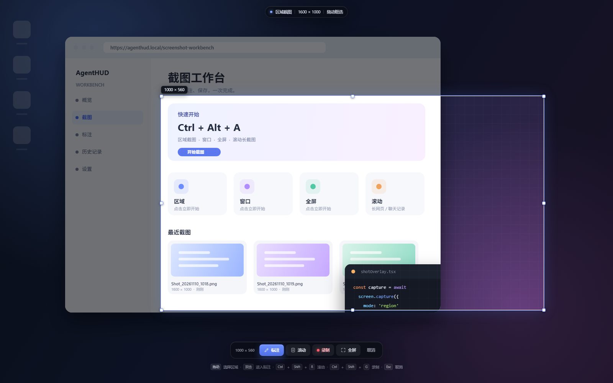
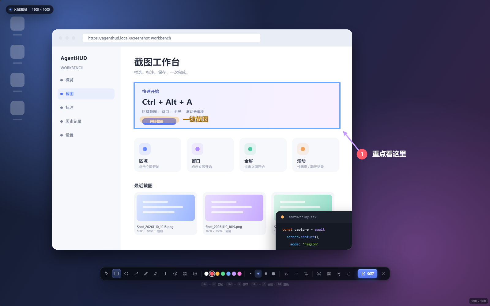
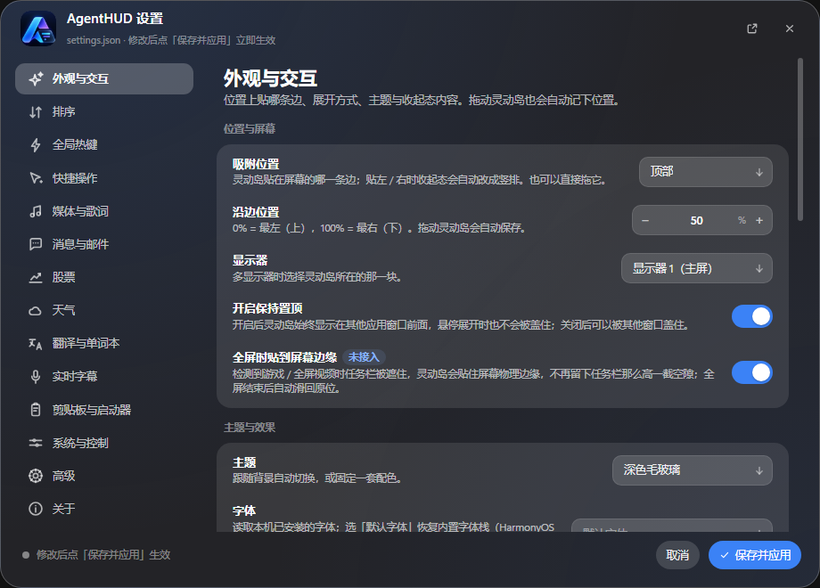
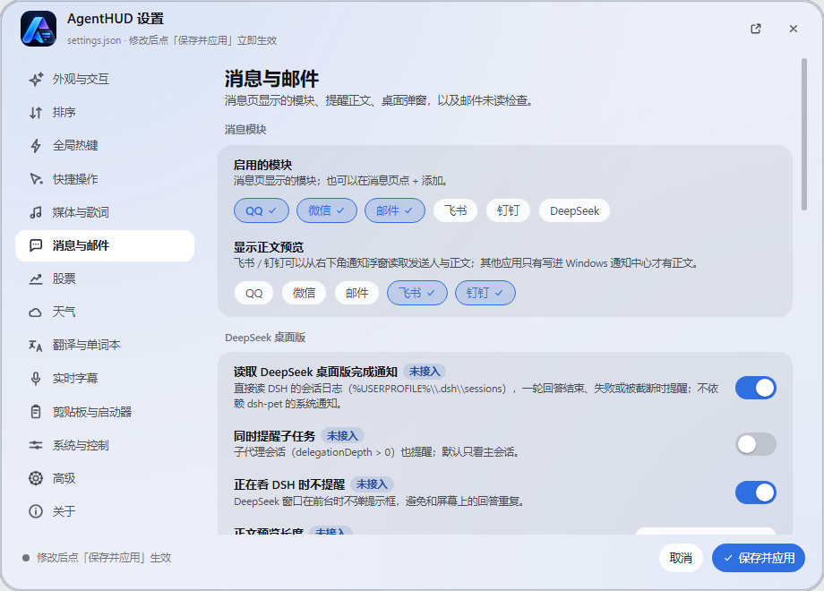
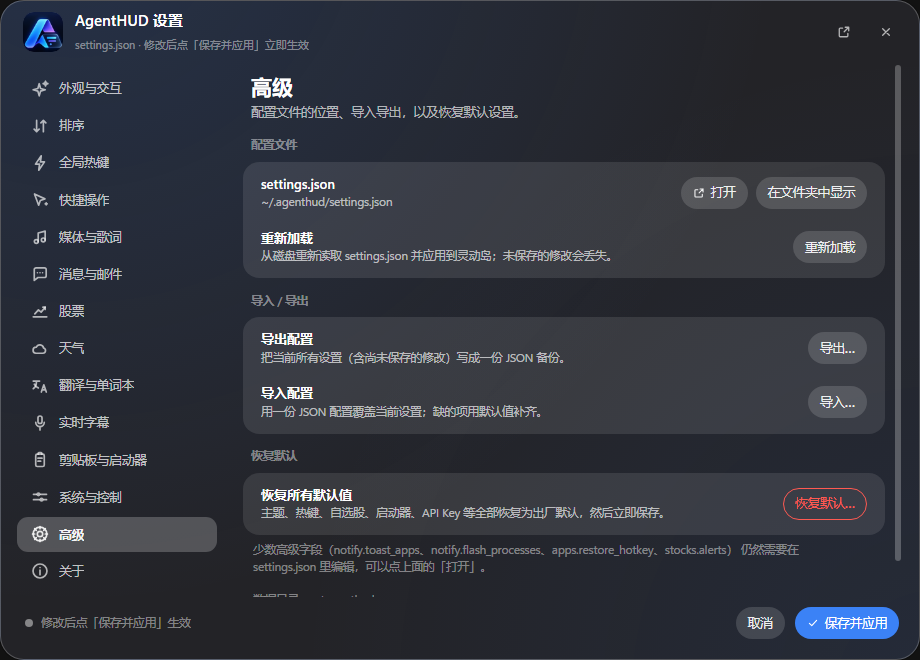

# 灵动岛 HUD（island）

灵动岛是支持四边吸附的液态毛玻璃胶囊，涵盖屏幕交互、液态几何和主题色，运行于 Tauri 2、
Rust 和 React。许可证见 [第三方声明](../THIRD_PARTY_NOTICES.md)。

透明置顶窗口画布为 780×632，展开面板宽 640。吸附到屏幕下边时，导航栏位于面板底部。

## 实现状态

### 已实现

- **窗口与几何**：780×632 透明画布 + 640 面板；四边吸附（含 bottom）；
  收起态高度 rings 54 / clock 34 / pet 34 / music 36 / activity 40。
- **交互**：悬停展开（默认 120ms）、移出收起（默认 320ms，均可配）；单击延迟展开
  + 600ms pin；双击切长关；`hover / always / never` 三态；滚轮切收起视图、导航切页；
  右键菜单、Windows 鼠标穿透、全屏隐藏和全局热键。Windows 可在同屏全屏时将当前吸附边移到物理屏幕边缘。
- **收起态**：额度环 / 时钟 / 特效眼 / 音乐四视图 + 消息 / 音量 / 股票 activity，
  彩色未读角标，30s 自动轮换（clock↔pet），音乐自动切视图 / 暂停 8s 回原视图。
- **主题**：auto / light / dark / rouge / sky；auto 按桌面底板亮度 0.64 / 0.42 阈值
  + 3s 滞回切换。
- **液态动效**：贴边内凹圆角、圆角呼吸、沿边流光、按压凹陷、拖拽泪滴形变、
  液桥拉丝、断桥残滴和吸附冲过挤压回弹。玻璃底板采用实时桌面纹理与边缘折射。
- **消息**：toast 通知库（A 路）、任务栏闪烁 `HSHELL_FLASH`（B 路）、
  飞书 / 钉钉右下角浮窗 UI Automation（D 路）、模块开关、磁贴 / 历史 / 全部已读 /
  清空 / 点击打开来源应用。
- **数据与状态**：拖拽窗口弹簧（900 / 0.78，240Hz 子步进）、松手最近边吸附、
  `posFrac` / 多显示器记忆、配置热更新。
- **截图工作台**：区域 / 窗口 / 全屏 / 滚动截图 / 标注 / 贴图 / OCR / 二维码 /
  录屏，见下文「截图工作台」。
- **实时字幕**：系统声音 / 麦克风 →
  Silero VAD 断句 → 日语 Parakeet 识别 → 流式中文翻译，见「数据链路 →
  实时字幕」。

### 设计取舍

- **绘制后端**：轮廓在 WebView 中使用 SVG 路径，将本体、液桥和残滴的曲线求并集。
- **全局热键**：用于切换灵动岛可见性。
- **收起态 rings**：`CollapsedPill` 为每个 agent 显示额度。可选在图标右侧竖排剩余百分比
  或在图标周围绘制同心环，下方显示订阅档位。clock / pet / music 使用 `CompactView.tsx`。
- **主页高度**：主页已按 3 列额度卡 / 单行动作压实，640×492 下内容自然高度约
  443px，沿用整页 fit 缩放（默认字号实测 0.975，不裁切、无滚动条），不是 1:1；
  字号超过 1.2× 时 fit 允许继续下探到约 0.78 兜底。
- **设置窗口**：设置放在独立的 920×660 透明圆角窗（14 页分类，见「设置窗口」），
  控件 / 版式全部自绘；配置以 `settings.json` 为权威文档、与岛运行时 SQLite
  双向同步；`live.*` 实时字幕也已接线，见「数据链路 → 实时字幕」。
- **全局热键**：默认 `Ctrl+Alt+Shift+I`（`Ctrl+Alt+I` 常被输入法占用，故加 Shift；
  可在设置窗口改）。
- **`blurFps`**：配置契约保留（默认 8，Rust clamp 1–60，设置文档 2–30），已驱动
  前端底板抓屏节奏：展开及拖拽时约 `1000/fps` ms 一拍，收起静置时约 3 倍（每拍至少间隔 60ms）。
- **通知 C 路**：Thunderbird mbox 兜底不实现（见「未实现」）。
- **死代码**：未接线 / 实验性的分支不纳入实现，只按实际生效路径实现。

### 未实现

- **Thunderbird mbox 通知来源**（C 路）。
- **macOS Wi-Fi / 蓝牙开关**、**跨平台桌面模糊**等见文末
  「未实现 / 已知差异」。
- **设置文档里仍未接线的键**（设置窗行内显示「未接入」，只存盘、不影响运行时）
  只剩平台差异项（`UNSUPPORTED_PATHS` 为空；Windows 上已完全没有只存盘项）：
  - 非 Windows 平台的等价能力（`island.exclude_from_capture` /
    `island.hug_fullscreen` / `media.netease_log` / `media.playback_logs` /
    `dsh.skip_when_active` / `clash.*` / `brightness.twinkle`）由
    `unsupported()` 动态标「未接入」。
- **天气数据源 / 亮度 / 程序路径已接线**：`weather.api_key`（非空走 OpenWeather，
  失败回退 Open-Meteo）、`weather.units`、`weather.interval_min` 由
  `island/weather.rs` 后台线程消费；`brightness.twinkle` 由
  `island/system.rs` 的 Windows 亮度分支消费；`notify.open.*` 与 `clash.app`
  在启动时自动探测填空（见「数据链路 → 消息」）。

## 效果

| 收起态：额度 + 天气 + 今日用量 | 竖排：贴左右边 |
| --- | --- |
|  |  |

| 展开：主页 | 天气 | 控制 |
| --- | --- | --- |
|  |  |  |

> 设置不在岛内：右上角齿轮打开独立的「灵动岛设置」窗（920×660、透明圆角 24、
> 14 页分类），见下方「设置窗口」。

| 截图工作台 | 区域选择 | 标注器 |
| --- | --- | --- |
|  |  |  |

## 窗口与几何

| 项 | 数值 |
| --- | --- |
| 常驻窗口 | 780×632（开合时保持画布尺寸，主体尺寸随展开状态变化） |
| 面板 | 640 宽（`--panel-w`），左右各 1px 边框后内容宽 638 |
| 面板高度 | 按标签常量表：home 492 / msg 380 / stock 440 / weather 440 / ctl 464 / clip 424 / shot 448 / tool 440（切页 440ms 弹簧补间） |
| 面板硬上限 | 492（窗口 520 高，上下留透明投影位） |
| 上/下横条 | 收起胶囊距屏幕边 6px（顶部 6px“呼吸位”），四周 16px 透明投影留白；展开面板距边 9px（6 + 3） |
| 左/右竖条 | 收起时额度环按账号数量调整宽高，音乐为 48px 宽、高度随内容变化。其余视图为 48×440。展开面板贴对应边抽屉式拉出 |
| 展开圆角 | 26px |
| 收起圆角 | 按视图高度 `min(30, h/2)`（rings 27 / clock 17 / pet 17 / music 18 / activity 20） |

收起态四视图高度与宽度公式（画布 780、内容上限 640）：

| 视图 | 高度 | 宽度 |
| --- | --- | --- |
| rings（额度环） | 54 起，换行时增高 | 按天气、额度环与周期文字、今日 token / 花费的实际宽度适配，上限 640px。到达主体尺寸上限后，额度区可滚动 |
| clock | 34 | 基准 150px，有天气时加 64px，未读角标按尺寸加宽，上限 640px |
| pet | 34 | 基准 150px，未读角标按尺寸加宽，上限 640px |
| music | 36 | 取最长歌词行与歌名／歌手中较长的文本，按当前字号和字体测宽，并留出封面、音频条、播放按钮、角标和额度环空间。上限 640px |
| activity | 40 | 音量为 280px。通知和股票提醒按当前字体、标题、副标题及图标测宽，范围 220–640px |

- **音乐视图的额度环**：播放、暂停、切歌和无曲目时均保留。音乐会话有曲目时，收起态的时钟、特效眼和临时提醒也显示额度环。横向停靠时额度环在内容右侧，竖向时在下方，超出的账号可滚动查看。
- **四边吸附**：`edge` 取 `top / bottom / left / right`；`posFrac` 是沿边比例
  （top/bottom 按横坐标、left/right 按纵坐标）。`bottom` 镜像 `top`：窗口贴工作区
  下沿，胶囊距窗口底 6px，条上方留 16px 投影位。展开时 `bottom` 面板从底部向上
  生长，**导航栏在面板靠近底边一侧**；top / left / right 行为不变。
- **拖拽期间**：原生窗口跟随主体，前端按当前窗口坐标绘制屏幕边线、液桥和残滴。
- **hover 热区**：收起态把胶囊 `getBoundingClientRect()` 按「相对 webview 左上角」
  上报给 Rust（`island_set_hover_rect`），透明留白不算热区；用 `ResizeObserver`
  在尺寸稳定 2 帧后重报，clock / pet / music / activity 切换与角标变化都会同步更新热区。
- **多显示器**：拖拽范围是所有显示器工作区的并集；落盘 `monitor`，重启/展开留在
  同一块屏。

## 交互

- **悬停**：「设置… → 外观与交互 → 展开与收起 → 悬停默认展开」默认开启。
  开启后，指针进入胶囊并停留 `hoverExpandMs`（默认 120ms，Rust clamp 0–2000ms）
  即展开；关闭后，在悬停模式下单击胶囊才展开。移出后 `collapseDelayMs`（默认
  320ms，clamp 0–4000ms）收起。宽高走弹簧
  曲线。展开使用 420 / 0.62，切页使用 440 / 0.6，收起使用 460 / 0.64。
  玻璃到达目标尺寸后，内容按 700 / 1.0 弹簧淡入。
- **单击**：短按并释放收起态胶囊，在双击间隔结束后展开，并在 600ms 内保持展开。
  原地长按松手不展开；按住并移动超过拖动阈值会拖拽灵动岛，松手只结束拖拽。
- **双击**：非交互区域双击切换 `never`（长关）↔ `hover`；排除按钮、`[role='button']`、
  额度卡 `.agent-card`、右键菜单与 `[data-no-dblclick]`，避免双击卡片误切长关。
  常驻展开时双击也切到长关并立即收起。
- **展开方式** `expandMode`：
  - `hover`：悬停或单击展开（由 `hoverExpand` 控制）、移出收起；
  - `always`：常驻展开，点击收起会同时切回 `hover`（否则没有自动展开入口）；
  - `never`：长关，双击恢复悬停展开。
- **滚轮**：
  - 收起胶囊：按 `rings → clock → pet → music → rings` 循环切视图；
    250ms 节流；activity 期间忽略，展开态忽略钩子转发的 `zbar://island-wheel`；
    切换写入 `compactView` 配置并清掉音乐暂停回退计时。
  - 导航栏：在可见标签间上一页 / 下一页，到边界停住。
  - 主页额度区：左右翻页。
  - 可穿透模式：Rust 低级鼠标钩子转发 `zbar://island-wheel`（±1，正 = 向上），
    与 DOM 滚轮走同一个切视图函数。
- **右键菜单**：展开 / 收起、主题（auto / light / dark / rouge / sky）、展开方式
  （hover / always / never）、显示板块（消息 / 股票 / 天气 / 控制 / 剪贴板 / 截图 / 工具 /
  翻译，勾选写 `hiddenTabs`）、可穿透开关、玻璃透明度滑杆、刷新数据、打开主窗口、
  关闭灵动岛、退出 AgentHUD。菜单坐标来自事件 / 指针位置，面板内自动夹边。
- **板块显隐**：右键菜单「显示板块」与设置窗「外观与交互 → 板块」同一份
  `hiddenTabs`；可隐藏项为消息 / 股票 / 天气 / 控制 / 剪贴板 / 截图 / 工具 / 翻译，
  仅主页固定。隐藏后立即停掉对应后台工作：股票 = 行情轮询；消息 = 通知轮询 +
  飞书 / 钉钉浮窗扫描 + DeepSeek 完成监听 + IMAP 邮件轮询（含任务栏闪烁 hook，
  都挂在 notify 的线程组里）；截图 = 销毁截图 / 录屏预热窗口；控制 = 系统状态轮询；
  剪贴板 = 剪贴板监听。天气与媒体因主页 hero / 媒体卡与收起态仍在展示，保持轮询；
  工具 = 兜底结束正在进行的会议录音：走正常停止流程（WAV 收尾 + 侧车 JSON 落盘，
  已录内容正常保存；`agenthud-meeting-rec` keeper 线程停流退出，不保留后台录音），
  没有进行中的录音则不做任何事。翻译没有后台线程（命令式调用），隐藏后前端不再
  挂载页面即可。灵动岛总开关关闭时同样结束正在进行的会议录音并正常保存（见
  `stop_services`）。重新显示时消息走 `notify::resume`（只重启线程、不重读
  历史，未读不清零），截图延迟 1.5s 再预热；`audio_peak` 采样线程 30s 无前端调用
  即自停，下次 `island_audio_peak` 命令再拉起。
- **设置…**：右键菜单的「设置…」和展开面板的齿轮均可打开独立的「灵动岛设置」窗口。
- **拖拽**：按住胶囊或展开面板空白处移动。超过拖动阈值后，主体按
  跟手弹簧（900 / 0.78，240Hz 子步进）追随光标。展开面板先收成胶囊。松手时按最近边
  吸附，左右边距离的权重为 1.35。落位后保存 `edge`、`posFrac` 和 `monitor`。
- **可穿透**（Windows）：配置 `passthrough=true` 后给岛窗口加
  `WS_EX_TRANSPARENT`，并安装 `WH_MOUSE_LL` 低级鼠标钩子；右键在光标命中岛时由
  Rust 协调线程（≤50ms）临时清掉透明位、广播 `zbar://island-passthrough-menu`
  `{x,y}` 并开 **2s grace**；前端在该坐标打开同一份右键菜单，菜单关闭
  （选项 / 点外部 / Esc / 组件卸载 / 1.9s 兜底）都调用
  `island_passthrough_restore()` 立即恢复穿透。grace 期内左键点在岛外也会被
  Rust 取消 grace。滚轮事件由钩子吞掉并转发给前端（展开态前端直接忽略）。
  可穿透右键菜单不再强制展开面板：打开期间抑制 hover 展开/收起，关闭时恢复到
  打开前的展开状态；若用户点了菜单项（如「展开灵动岛」）则以动作结果为准。
  非 Windows 平台该配置不生效。
- **全屏隐藏**：`hideFullscreen=true` 时前台全屏应用会让岛隐藏，退出全屏恢复。
- **全局热键**：默认 `Ctrl+Alt+Shift+I` 开关灵动岛总开关；是否注册成功可查
  `island_hotkey_registered`。

## 收起态（四视图 + activity）

- **rings（默认）** 显示天气、今日 token 与预估花费。同一来源的多个账号或凭证各自显示额度。
  「外观与交互 → 收起态 → 额度环显示方式」可切换百分比和纯额度环。
  百分比模式在图标右侧显示可用周期的剩余额度，例如 `96% 5h`、`82% 周`、`72% 月`。
  纯额度环用绿色表示 5h、黄色表示周、蓝色表示月，弧长表示各周期剩余额度。可用周期依次从外向内排列，缺失周期省略。
  档位在环下方。账号增减时，胶囊随内容伸缩。上下停靠
  时额度环可换行，左右停靠时可加列。达到 640×492 的主体上限后，在额度区滚动可查看其余账号。
- **clock**：`HH:MM` + 天气 + 未读角标。
- **pet**：两枚发光眼睛的极简小形象（`PetFace.tsx`，SVG + rAF 弹簧），会随指针
  方向看、随机小情绪、60s 犯困、眨眼；收到新消息会惊讶 1.4s（不是桌面宠物）。
- **music**：封面 / 歌词或「标题 · 歌手」跑马灯（2s 停顿 + 34px/s）+ 律动条 +
  播放暂停按钮（常驻圆形底，和律动条区分）+ 未读消息来源图标；律动条透明度 0.62（暂停态
  0.28）。收起态播放时约 30Hz 读取真实音频峰值 `island_audio_peak`（0–1），供律动条和
  液态轮廓共用。微弱声音也能触发，短暂的零值保留约 100ms，持续静音后逐步收回波动。
- **实时字幕覆盖层**：聆听中收到字幕时，横条胶囊优先显示最新一句（上日文 /
  下中文，中文未出时显示「…」，超宽保留句尾），280ms 淡入，高度 60、
  宽 `min(640, 可用宽度)`（下限 240）；最后一句后 7s 回原视图，停止聆听立即
  收回。临时提醒 activity 仍优先于字幕；左右竖胶囊不显示（48px 宽放不下两行）。
- **activity（临时提醒）**：优先级高于普通视图，宽度按内容；三种来源：
  - 新通知：最新一条 4s，pet 同时惊讶；
  - 音量 / 静音变化：1.8s，播放中原地更新滑条；初始值和展开态不弹；
  - 股票异动：5s，红涨绿跌。
- **未读角标**：音乐视图、小形象视图和播放期间的时钟视图使用 20px 消息来源图标。时钟视图在
  暂停或无曲目时使用 8px 圆点。每个有未读的来源显示一个角标，来源没有品牌图时用通用消息图标。
- **自动轮换**：`autoCycleSec`（默认 30s，0–600，0 关闭）在 **clock ↔ pet** 两个
  信息视图间轮换；用户交互后重新计时，activity / 展开态暂停。
- **音乐自动切视图**：开始播放或换曲自动切到 music 并记住原视图；暂停后等 8s
  再回原视图；若期间恢复播放、滚轮已切到其它视图或当前已不是 music，则不再
  抢回（暂停回退前会校验当前视图）。
- **收起态滚轮 / 右键**：见「交互」。

## 主题

| 模式 | 说明 |
| --- | --- |
| `auto` | 按桌面底板平均亮度自动选深/浅：指数平滑 0.8/0.2，深色时亮度持续高于 **0.64** 切浅色，浅色时低于 **0.42** 切深色，切换需持续 **3s** 滞回 |
| `light` | 浅色毛玻璃 |
| `dark` | 深色毛玻璃（默认） |
| `rouge` | 胭脂撞色 |
| `sky` | 晴空渐变 |

- 主题只改玻璃 tint / 描边 / 高光 / 文字 / 语义色（`data-theme` 挂在 `.island-root`），
  不随主题变的语义色（额度环绿黄红）单独定义。
- 卡片 / 磁贴默认去掉常驻 1px 描边，靠 `--panel` 明度与内高光分层；输入框、
  下拉、开关等控件仍保留边框。
- 玻璃透明度 `transparency` 可从 0 调到 90，由设置窗口和灵动岛的右键菜单共用。调节作用于玻璃底色、折射底板和染色层。
- WebGL 先做两趟半分辨率可分离高斯模糊，再沿圆角矩形 SDF 法线对边缘进行位移采样，叠加 RGB 色散和柔和高光。玻璃仍按灵动岛当前的液态轮廓裁剪。
- Windows 上，关闭「出现在截图和录屏里」后可采样窗口正下方的画面。着色器按液态轮廓的四角分别计算短距离边缘折射。允许截图显示灵动岛或对齐画面不可用时，由半透明主题底色直接透出实际桌面。相邻取样只用于自动主题的亮度判断。
- 没有外投影；玻璃只画在圆角形状内。

## 设置窗口

岛展开面板右上角的齿轮不再切岛内页面，而是打开独立的「灵动岛设置」窗口
（`island-settings.html`，Tauri label `island-settings`，Rust 侧
`island_settings_window.rs` 懒创建）：**920×660**（最小 760×520）、无边框、
窗口本体透明，页面里画一张圆角 24 的玻璃卡；自带 64px 标题栏（打开 settings.json /
关闭 / 拖拽）、208px 分类侧栏、62px 状态页脚，右侧是可滚动表单。窗口关闭 = 隐藏
（Rust 侧 `prevent_close + hide`），再点齿轮 `show + focus` 秒开；灵动岛总开关
关闭时设置窗一并收起，不会留下没有入口的孤儿窗口。

侧栏共 **14 页**（顺序固定）：

| 序号 | 页面 | 主要内容 |
| --- | --- | --- |
| 1 | 外观与交互 | 位置与屏幕（吸附边 / 沿边位置 / 显示器 / 保持置顶 / 全屏贴边）、主题与效果（主题 / 字体 / 字号 / 透明度 / 截图排除）、展开与收起（展开方式 / 悬停默认展开 / 延迟）、收起态（视图 / 额度环显示方式 / 轮换）、板块显隐（消息 / 股票 / 天气 / 控制 / 剪贴板 / 截图 / 工具 / 翻译，仅主页固定） |
| 2 | 排序 | agent 账号顺序（首帧 `island_quota_snapshot`，随后监听 `zbar://hud-bar-usage`），写回 `agenthud.agent_order` |
| 3 | 全局热键 | 开关 / 剪贴板 / 翻译三个热键的录制与 `island_hotkey_status` 注册状态 |
| 4 | 快捷操作 | 热键状态与常用动作（打开主窗口 / 关闭灵动岛 / 退出 AgentHUD），按钮立即执行、不受保存影响 |
| 5 | 媒体与歌词 | 自动切视图、播放日志、歌词源顺序（网易云 / LRCLIB / 自定义 URL 模板）、播放器优先级 |
| 6 | 消息与邮件 | 消息模块、正文预览、桌面玻璃浮窗（开关 / 位置 / 尺寸，独立窗口 `notify-popup`）、打开应用路径（启动时自动探测填空，手动保存过的项不再覆盖）、DeepSeek 桌面版完成通知、IMAP 邮件检查 |
| 7 | 股票 | 自选股、刷新间隔、涨跌幅提醒阈值 |
| 8 | 天气 | 数据源（可选 OpenWeather API Key、摄氏度 / 华氏度、5–180 分钟刷新间隔，均已接线）、绑定城市（留空跟随 IP）与自定义城市列表（坐标留空按城市名查询） |
| 9 | 翻译 | 选择已配置的平台及模型，或开启自定义接口填写 API Key、接口地址和模型，可测试翻译 |
| 10 | 实时字幕 | 运行状态（模型下载进度 / 取消 / 开始与停止聆听）、声音来源与设备、Silero VAD 断句、模型目录、日语识别（滚动草稿 / 草稿间隔 / 识别线程 / 单句上限）、翻译参数（启用 / 草稿翻译 / 节流 / 上文行数），16 项全部接线 |
| 11 | 剪贴板与启动器 | 剪贴板保留条数、主页应用启动器条目 |
| 12 | 系统与控制 | Clash Verge 配置目录 / 备用混合端口 / 程序路径（启动时自动探测，手动保存过的不再覆盖）、亮度 Twinkle 可执行文件路径（填写后亮度走 Twinkle 命令行 `--All --Set`，留空或失败回退 DDC/CI → WMI） |
| 13 | 高级 | 打开 / 定位 settings.json、从磁盘重新加载、导入 / 导出、恢复所有默认值（出厂默认） |
| 14 | 关于 | 当前版本与开源信息（检查更新统一在主窗口「关于」页） |

**草稿态**：所有输入只改内存里的扁平草稿，页脚实时显示「N 项修改未保存」；
主题切换在草稿里即时预览，其余控件点「保存并应用」（或 Ctrl/Cmd+S）后才生效。
保存前先全量校验：错误在行内红字提示，并自动跳到第一个错误所在页、滚动到该行；
通过后只把改动过的扁平点路径交给 `island_settings_save(patch)`。页脚「取消」、
右上角关闭与 Esc 在草稿有改动时都会先弹「放弃未保存的修改？」（无改动直接收起）。
每页页尾都有「恢复本页默认值」（二次确认，同样只改草稿）；「高级」页另有
打开 / 在文件夹中显示 settings.json、从磁盘重新加载、导入 / 导出 JSON、
恢复所有默认值（出厂默认，立即保存）。

这套 14 页设置窗走**独立设置文档通道**（见「配置 → settings.json（设置文档）」），
不再用 `island_config` / `island_set_config` 整份写回：首帧
`island_settings_doc` 一次取回文档 + 默认值 + 文件路径 + 未接线项，编辑草稿后
`island_settings_save(patch)` 只提交改动过的扁平点路径；重置 / 导入 / 导出 /
打开文件 / 在资源管理器中定位分别对应 `island_settings_reset` /
`island_settings_import` / `island_settings_export` / `island_settings_open_file` /
`island_settings_reveal_file`，`island_settings_paths` 给出文件与数据目录，
`island_settings_window_hide` 供「有未保存修改时确认关闭」调用。保存后 Rust 侧
对与岛运行时重叠的字段走 clamp → SQLite → 广播 `zbar://island-config` →
天气 / 股票 / 消息 / 热键副作用链路，并与 `island.db` 的 `IslandConfig` 双向同步；
未接线的键只存盘，由 payload 的 `unsupported` 驱动行内「未接入」标签（本轮
只剩非 Windows 平台的差异项）。

| 深色：外观与交互 | 浅色：消息与邮件 | 深色：高级 |
| --- | --- | --- |
|  |  |  |

浏览器预览可直接打开 `/island-settings.html`（数据层 `wset/settingsApi.ts` 的 mock
分支把文档存在 localStorage，路径显示 `~/.agenthud/settings.json`），不需要 Rust
也能调样式。

## 已实现

| 模块 | 内容 |
| --- | --- |
| 收起态 | 四视图（rings 54 / clock 34 / pet 34 / music 36）+ activity 40 + 彩色未读角标 + 30s 自动轮换（clock↔pet）；宽度公式见「窗口与几何」 |
| 主页 | 天气 hero、额度卡 3 列 / 每页 3 张（滚轮翻页、页码条命中区 ≥24×8；末页 2 张按两列铺满、1 张单列铺满）、余额 / 按量卡移出网格单独全宽一行、媒体卡（封面 52 + 标题 + 只读进度条 + 上一首/播放暂停/下一首）、小形象（PetFace 2.3×，眼睛跟随鼠标）、四动作整行 4 等分（保持展开 / 可穿透 / 静音 / 实时字幕开关，聆听中高亮并显示「聆听中」，标签 11.5px）、横向启动器（高 46 / 图标 44 / 滚轮横滑）；492 高不足时整页 fit 缩放兜底（默认字号实测 0.975，下限 0.92） |
| 消息 | 模块磁贴（84px、色圆 + 名称 + 未读数 + 最近 HH:MM）、`+` 添加 / 右键移除 / 清空该模块 / 全部已读 / 空白右键清空全部、历史最多 30 行（30px/行），点磁贴或历史打开来源应用；「打开应用」路径启动时自动探测（运行进程 → 卸载表 → 常见目录），只填空项、不覆盖手动保存过的值；来源与正文规则见「消息」 |
| 股票 | 腾讯财经 A/港/美股行情、分时、搜索添加、删除、涨跌提醒（阈值可调） |
| 天气 | OpenWeather（填 Key）与 Open-Meteo（免费免 Key）双数据源，`units` 温度单位（°C / °F）与 `interval_min` 刷新间隔（5–180 分钟）均已接线，OpenWeather 失败自动回退 Open-Meteo：顶部城市胶囊（主城市 / 绑定时当前 IP 城市 / 自定义城市，可横向滚动、带温度）、点选切换详情、`+` 内嵌搜索添加（城市名或「纬度,经度」）、右键胶囊绑定主城市 / 取消绑定 / 删除自定义城市；当前天气、8 项指标、5 天温度区间与逐小时（前 8 小时）；主城市默认跟随公网 IP（城市名经 geocoding 反查中文，失败保留英文），IP 不可用时取第一个自定义城市，没有城市显示空态；收起态胶囊显示主城市天气；设置窗可维护数据源、绑定城市（留空跟随 IP）与自定义城市列表 |
| 控制 | 音量 / 静音、亮度、Wi-Fi / 蓝牙、主窗口与 Clash Verge。Windows 上亮度可填 Twinkle Tray 可执行文件，走 Twinkle 命令行（`--All --Set`），留空或失败回退 DDC/CI → WMI；显示订阅流量、上传 / 下载速率、出口 IP / 地区，支持切换代理模式（规则 / 全局 / 直连）、系统代理和 TUN |
| 剪贴板 | 最近 10 条文本/图片，内存历史，点击写回剪贴板 |
| 截图 | 区域/窗口/全屏/延时截图、滚动长截图、标注器、贴图窗口、本地 OCR/二维码、录屏（MP4 最长 1 小时 / GIF 最长 5 分钟，可裁剪）、PNG/JPG 保存、自动复制/贴图、历史打开/编辑/复制/贴图/删除；详见「截图工作台」 |
| 媒体 | Windows SMTC、网易云本地播放日志和自定义播放日志；主页媒体卡与收起态 music 共用，播放控制由系统媒体会话提供 |
| 歌词 | 网易云公开接口按曲名+歌手取 LRC 与翻译；收起态 music 优先显示当前歌词并跑马灯滚动 |
| 翻译 | 输入或粘贴文本、翻译成简体中文、复制译文；默认显示，可在右键「显示板块」或设置「外观与交互 → 板块」切换 |
| 实时字幕 | 系统声音（Windows WASAPI loopback）/ 麦克风 → Silero VAD 断句 → Parakeet 日语 0.6B INT8 定稿 + 滚动草稿 → OpenAI 兼容流式中文翻译；收起胶囊显示最新一句（7s 回退、280ms 淡入，优先于其它收起视图，左右竖条不显示）、主页四动作开关（聆听中高亮）、翻译页历史（≤80 行、草稿行、滚轮上翻、回到最新、清空）、设置页模型下载与聆听状态；约 630MB 模型首次自动下载（HF / hf-mirror / GitHub Release），支持断点续传与取消；见「数据链路 → 实时字幕」 |
| 玻璃 / 主题 | 五套主题（auto/light/dark/rouge/sky）+ 透明度 0–90；auto 亮度采样 0.64/0.42 + 3s 滞回；双趟高斯模糊、边缘折射和 RGB 色散；无外投影 |
| 字体 | 设置窗「外观与交互」可用步进器设 10–18px（0.5 步进、恢复默认）；只缩放文字，图标和窗口几何不变 |
| 窗口 | 780×632 透明置顶不抢焦；上/下/左/右四边吸附，bottom 时导航在面板底部；收起/展开按边定位；全屏自动隐藏；Windows 不使用系统 Acrylic 背板 |
| 液体动效 | 贴边内凹圆角、圆角呼吸、沿边流光、按压凹陷、拖拽泪滴、液桥拉丝、断桥残滴、吸附冲过挤压 |
| 可穿透 | Windows `WS_EX_TRANSPARENT` + `WH_MOUSE_LL`；右键菜单 / 滚轮事件转发；2s grace + 前端 1.9s 收口 + `island_passthrough_restore` |
| 设置 | 齿轮打开的独立小窗（`island-settings.html`，920×660、透明圆角 24、自绘标题栏 + 14 页分类侧栏 + 状态页脚）；草稿态 + 保存并应用 / 取消 / Ctrl+S / Esc 确认 / 校验定位 / 恢复本页默认值 / 导入导出 / 恢复出厂；配置走独立 `settings.json` 文档通道并与岛运行时双向同步；板块可显隐（消息 / 股票 / 天气 / 控制 / 剪贴板 / 截图 / 工具 / 翻译，仅主页固定，隐藏即停对应后台资源，见「交互 → 板块显隐」）；窗口关闭 = 隐藏，随灵动岛总开关一并收起 |
| 配置 | `~/.agenthud/settings.json` 是设置窗的权威文档（原子写、只写 patch 键、未知额外字段原样保留）；与 `~/.agenthud/island.db` 的 `IslandConfig` 双向同步；首启 seed；旧 `island.json` 自动迁移进 SQLite |
| 其它 | 全局热键、右键菜单、配置热更新、旧 HUD 与旧 JSON 配置自动迁移、多显示器记忆、全屏隐藏 |

## 消息

| 来源 | 实现 |
| --- | --- |
| A. Windows toast 通知库 | 只读轮询 `wpndatabase.db`（每 2s），把 toast XML 文本映射成 qq / wechat / mail / feishu / dingtalk；首次读最近 50 条作为已读历史，之后新增计未读。不申请通知监听权限、不读聊天存储 |
| B. 任务栏闪烁 `HSHELL_FLASH` | 隐藏顶层窗口 + `RegisterShellHookWindow` 收 shell hook；按闪烁窗口进程名映射 kind，同 kind 8s 去重，走与 toast 相同的 items / 过滤链路（id 合成负数、sender/body 为空） |
| C. Thunderbird mbox | **未实现**（参考实现的兜底路，不在本轮范围） |
| D. 飞书 / 钉钉浮窗 | 每 1s `EnumWindows` 找工作区右下角的无边框置顶工具窗口（160–900 × 40–600），用 UI Automation 读发送人 / 正文（读不到只提醒「新消息」） |
| E. DeepSeek 桌面版 | 增量读取本地 DSH 会话日志，回答完成、失败或被截断时生成消息。可控制子助手、预览字数和 Windows 前台时的提示框 |
| F. IMAP | 用 SSL/TLS 定期只读检查 `INBOX` 的新增未读邮件，每个账号每次检查最多生成一条数量提醒 |

- **模块开关**：`notifyModules`（默认 `["qq","wechat","mail"]`，
  Rust 归一化顺序 qq/wechat/mail/feishu/dingtalk/dsh，允许空数组 = 一个都不显示）；
  `notifyBodyPreview`（默认 `["feishu","dingtalk"]`，控制哪些模块额外读正文）。
  消息页磁贴 / 历史 / 角标 / 未读都按当前开关过滤。
- 在设置的「消息与邮件」中启用 DeepSeek 模块和「读取 DeepSeek 桌面版完成通知」。日志目录默认 `~/.dsh/sessions`。开启「前台不弹窗」时，Windows 前台的 DeepSeek 回答仍会进入消息列表。
- 邮件模块需要启用，并填好 IMAP 服务器、端口、账号与授权码或应用专用密码。默认端口为 993，默认间隔为 120 秒。首次成功检查建立基线，后续新增未读才提醒。首次导入 Thunderbird 账号时只预填服务器、端口和用户名。
- **磁贴页**：84px 模块磁贴；`+` 菜单列出未添加模块，点击写 `notifyModules`；
  右键磁贴可「清空该模块消息」（`island_notify_clear(kind)`）或「移除模块」（写
  `notifyModules`）；「全部已读」对每个显示模块调
  `island_notify_mark_read_kind(kind)`（只清未读、不删历史）；历史 / 空白右键
  「清空全部消息」（`island_notify_clear(null)`），不删模块；保留「打开系统
  通知设置」入口；`notifyModules=[]` 时仍渲染 `+` 与空态。
- **历史行**：最多 30 行 × 30px，kind 圆点 + 模块名 + 描述 + HH:MM；点击打开来源
  应用（优先 `notifyOpen.<kind>` 配置路径，其次按 `exe` 聚焦已运行窗口，最后按
  常见安装路径启动）；磁贴点击同样打开来源应用并清该
  模块未读。
- **微信未读汇总**：消息页将微信未读合为一行，显示灵动岛记录的未读总数。通过灵动岛打开微信或将消息标为已读时，汇总行随未读记录清除。
- **文本规则**（Rust）：`sender` 仅 qq/wechat/feishu/dingtalk，且（有第二条文本或
  该 kind 未开正文预览）时取第一条前 **40 字**；`body` 仅给开了正文预览的 kind，
  取第二条（没有则第一条）前 **120 字**。前端描述再按「有 body → `发送人：正文`；
  mail → `新邮件`；有 sender → `发送人 发来消息`；否则 `新消息`」补全。
- **事件 / 命令**：`zbar://island-notify` 推送 `{items, unread, wechatUnread}`；
  `island_notify` / `island_notify_mark_read()` / `island_notify_mark_read_kind(kind)` /
  `island_notify_clear(kind?)` / `island_notify_open(kind, exe?)` /
  `island_notify_modules()`（返回 `{modules, bodyPreview}`）。

### 桌面玻璃提示框（`notify-popup`）

浮窗**不能**画在岛窗口里：岛是固定 780×632 的透明
画布，画布上胶囊以外的像素由 Rust 的 16ms 轮询设成点击穿透，浮窗要收鼠标
（hover 暂停 / 点击打开）就必须是独立窗口。

- **窗口**：label `notify-popup`，`transparent` + `decorations(false)` +
  `always_on_top` + `skip_taskbar` + `focusable(false)`（不抢焦点）+
  `shadow(false)` + `resizable(false)`，**不**设 ignore_cursor_events；首条新
  消息到达时懒创建（隐藏态，WebView2 冷启动与下方 1.2s 等待重叠），空闲
  `hide()`，尺寸紧贴当前卡片堆叠（每次堆叠变化前端量出堆叠矩形，调
  `notify_popup_resize(width, height, pad)`）。唯一的例外是**贴边一侧的 `pad`
  透明带**（= 10px × size/100）：退场要朝屏幕边缘位移 10px，这条带子就是它的
  落脚处，`pad` 一起交给 Rust，Rust 按「窗口尺寸 − pad」反算，保证卡片本体
  仍距工作区边 16px。关掉 `notify.popup.enabled` 或岛总开关时直接收起。
  `island.exclude_from_capture` 同样作用于浮窗（建窗时与保存配置时都会设
  `WDA_EXCLUDEFROMCAPTURE`），共享画面 / 录屏里不会漏出通知正文。
- **卡片（逻辑 px，100% 设计稿）**：360×84、圆角 18、1px 描边 + 内层半透明
  卡片 + 1px 边缘高光；左侧 3px 品牌强调条（距上下边各 16）；图标 chip 38×38
  （白底圆角 10.26、品牌图 inset 9%，与参考 `paint_icon_chip` 同口径）；标题
  13.5px 半粗、副标题 11.5px 次级色，均单行省略。整体按 `notify.popup.size`
  （70–160，默认 100）等比缩放，卡间距固定 4px 不缩放。
- **位置**：六选一 `center_bottom` / `center_top` / `bottom_left` /
  `bottom_right` / `top_left` / `top_right`（顺序与设置页同一份常量）。基准是
  **岛所在那块屏的工作区**（排除任务栏），边距 16px；`center_*` 是「贴上下沿 +
  水平居中」，不是屏幕正中。
- **堆叠**：内部数组 `cards[0]` 是最贴屏幕边缘的那条 = 最早到达的那条，新卡
  追加到末尾（最靠内侧）；最多 5 条（`maxCards` 还会按可用高度
  `工作区高 - 32` 收窄）；超限时**秒删 `cards[0]`**，不播退场，其余条目
  180ms 让位。
- **时序**：新消息到达后先等 **1200ms**（`POPUP_DELAY_MS`，与岛端「惊讶表情 →
  呼吸灯 + 活动卡」的编排同源，两边改一起改），这 1.2s 内到达的同类消息合并成
  一批统一出卡（延迟结束时重读开关，关掉就不出卡）；出卡时 180ms OutCubic
  淡入；每条独立计 3000ms；hover 暂停（丢弃剩余时间）、移出重新计满 3s；
  点击立刻关闭（不播退场）并调 `island_notify_open` 打开来源应用；到期
  260ms 退场（朝贴边方向位移 10px + 缩到 86%，OutCubic；透明度 → 0 用
  InCubic），槽位留到退场结束，其余条目再 180ms 滑进去。
- **「新到」判定**：数据库 toast 的 id 单调递增，且判新要求「比已见最大值更大
  **并且未读**」——历史回填（`notify::init_history`）会把读到的条目全部标成
  已读，所以「岛关了再开」重新读入的那批历史天然被挡掉，不会补弹；飞书 / 钉钉
  浮窗与任务栏闪烁用的是**负数合成 id**（逐条递减），按「没见过这个 id、且到达
  时间在 15s 内」判。`notify::start/stop` 会调 `popup::reset_baseline()` 清基线
  + 未出卡波次；通知库为空时 `init_history` 也会把游标置为已初始化，干净库的
  第一条真实通知不会被当成历史吞掉。
- **事件 / 命令**：`zbar://notify-popup-show`（`{items, config}`，同波次按到达
  顺序）、`zbar://notify-popup-config`（配置快照：`enabled` 浮窗开关、
  `islandEnabled` 岛总开关——任一为假页面立刻清卡并隐藏、`position` / `size` /
  `theme` / `modules` / `maxHeight` / `maxCards`）；`notify_popup_ready()`
  （挂载握手 + 交出冷启动期间攒下的第一批）、
  `notify_popup_resize(width, height, pad)`、`notify_popup_hide()`。
- **设置接线**：`notify.popup.enabled` / `position` / `size` 从
  `UNSUPPORTED_PATHS` 移入 `SYNCED_PATHS`（`apply_config` 变化即广播，设置页
  不再显示「未接入」）。

## 翻译

灵动岛「翻译」板块使用已保存的翻译来源。设置窗「翻译」页的 `translate` 分组走**直接读 `settings.json` 的命令链路**，
不经过 `IslandConfig`；页内「测试翻译」只读已保存的配置，不保存草稿。

- 自定义接口默认关闭。平台模式使用已配置的凭证，平台与模型选择分别保存到
  `translate.platform` 和 `translate.platform_model`。平台与模型列表通过
  `island_translation_platforms` 和 `island_translation_models` 读取。
- 开启「自定义接口」（`translate.custom_enabled`）时，填写 API Key、接口地址和模型，
  对应 `translate.api_key`、`translate.base_url` 和 `translate.model`。两种来源二选一，
  关闭自定义接口后会保留已填写的内容。`translate.import_from` 仅用于兼容旧配置。
- 命令 `island_translate(text, target?) -> {text, translation, model}`：空文本 /
  未配置 Key / 网络失败 / 非 2xx / 空译文都返回中文错误；`target` 目前只支持
  中文（保留参数）。错误文案带 HTTP 状态码，服务端详情会先截断并抹掉 Key。
- 设置页「测试翻译」用示例句子 `Hello, world!` 调一次，结果显示在页脚状态栏。
- **剪贴板翻译热键**：`hotkeys.translate` 默认 `Ctrl+Alt+J`；与开关 / 剪贴板
  热键重复时跳过注册（开关 > 剪贴板 > 翻译）。触发后后台线程读剪贴板文本
  （空 / 非文本通知「剪贴板里没有文本」）→ 翻译 → 译文写回剪贴板，并弹通知
  「翻译完成」+ 译文前 120 字；失败弹「翻译失败」+ 原因。网络与剪贴板读写都在
  后台线程，不阻塞主线程。`island_hotkey_status().translate` 反映真实注册状态。
- **实时字幕历史**：翻译页底部内嵌实时字幕面板（开始 / 停止聆听、运行状态、
  电平条、字幕历史）。历史来自 `live_captions` 首帧 + `zbar://island-live-caption`
  增量，最多 80 行（草稿行随识别 / 翻译刷新，定稿不再变）；滚轮上翻查看时
  浮出「↓ 回到最新」，可清空（`live_clear_captions`）。

## 液体动效

| 效果 | 实现要点 |
| --- | --- |
| 贴边内凹圆角 | 贴边时本体与液桥合成一个轮廓，边缘处过渡为 13px 的贝塞尔内凹弧 |
| 圆角呼吸 | 贴边收起时，圆角以 1.7 rad/s 的角频率在基准值上下浮动 7% |
| 沿边流光 | 沿轮廓缓慢游走的高光 |
| 按压凹陷 | 悬停及按住时沿远离屏幕边的轮廓产生局部凹陷，松手后由欠阻尼弹簧回弹 |
| 拖拽泪滴 | 速度驱动后缘拖尾及收窄，前缘略微鼓起 |
| 液桥拉丝 / 断桥残滴 | 液桥沿工作区边线拉出沙漏形颈部，离边超过 64px 断开；残滴留在屏幕边缘缩回，靠近到 30px 后重新接通 |
| 吸附冲过挤压 | 松手时速度投影到沿边与法向弹簧，越过边线时主体压扁，随后回弹 |
| 玻璃折射 | 每张新桌面纹理做两趟高斯模糊，液态动画在模糊纹理上更新折射坐标 |

## 截图工作台

截图页（标签栏最后的相机）与抓屏器、标注器分离：截图页只负责入口、最近截图
和设置；真正的框选/标注在覆盖当前显示器的 `shot.html` 窗口里完成。

- **一个快捷键 + 覆盖层切分类**：`Ctrl+Alt+A`（设置项 `hotkey`，可改）统一呼出覆盖层，
  底部截图条上是 **截图 / 滚动截图 / 录屏** 三个分类，呼出后随时切换；不再为区域/窗口/
  全屏各注册一个全局热键（旧配置里的 `hotkeyRegion/hotkeyWindow/hotkeyFull` 读取时自动
  合并成 `hotkey`，优先取 `hotkeyRegion`）。
- **选区分支全部同时可用（飞书式）**，不需要先切模式：
  - **拖动** = 框选任意区域（八个把手可调、可整体拖动）；
  - **悬停窗口 + 单击** = 选中整个窗口（鼠标移动时描边高亮并显示 `应用名 · 标题`，
    在窗口内部继续拖动则框选窗口里的局部）；
  - **在桌面/没有窗口的地方单击** = 整屏选区；整屏选中后仍可直接拖出新区域。
  macOS 用 CoreGraphics `CGWindowListCopyWindowInfo` 在抓屏那一刻取窗口快照（保留
  灵动岛、排除其它自家窗口、换算成抓屏图像素），替换了 `screencapture -w` 的独立选窗。
- **HUD 也能被截到**：抓屏时不再隐藏灵动岛，冻住的画面里就有 HUD，区域/全屏/选窗都能
  把它截进来；抓完才把岛藏起来，免得它浮在覆盖层上。窗口快照同时包含
  `AgentHUD Island`，所以也能直接单击选中 HUD 窗口本身。录屏时会把岛放回屏幕再录，
  结果和选区预览一致。
- **分类动作**：`截图` → 选完直接进标注器；`滚动截图` → 开始滚动拼接；`录屏` →
  先选 MP4 / GIF 与是否录鼠标，再点「开始录制」。选区在三个分类之间共用，
  切换分类/点工具条按钮都不会丢选区。
- **延时**：0/3/5/10 秒，先隐藏 HUD 与自身窗口再抓屏。
- **滚动长截图**：框选后按 `Ctrl+Shift+R`（或点“开始滚动”），编辑器移出屏幕，向选区中心窗口发送真实滚轮消息，逐帧抓取并按行签名拼接；支持网页、聊天记录、文档等常规滚动容器。Windows 走 `PostMessage`+`mouse_event`，macOS 用 CoreGraphics `CGEventCreateScrollWheelEvent` 投像素级滚轮事件（首次使用需在「系统设置 → 隐私与安全性 → 辅助功能」里勾选 AgentHUD，未授权会给出明确提示）。
- **标注器**：矩形/椭圆/箭头/画笔/高亮/文字/序号/马赛克/模糊，颜色与线宽、撤销重做、重新框选。
- **贴图**：`Ctrl+P`，把当前画面钉成无边框置顶窗口，可拖动、按比例缩放、复制、保存。
- **本地 OCR**：`Ctrl+Shift+O`，走 Windows.Media.Ocr，不联网；结果可直接复制。
- **二维码**：`Ctrl+Shift+Q`，本地 `rqrr` 解码，结果可复制。
- **录屏**（飞书式）：框选后选 `MP4` / `GIF`、是否画鼠标，点「开始录制」或
  `Ctrl+Shift+G`。覆盖层隐藏（录制期间不显示），屏幕右下角浮出录制条
  （`rec.html`），显示已录时长 / 时长上限（MP4 1 小时、GIF 5 分钟）和「结束」；
  点「结束」后录制条原地放大成预览窗：
  `<video>` 播放、时间轴两端拖动裁剪、复制（文件写到剪贴板）/ 下载（另存为）。
  - 抓帧走 CoreGraphics `CGWindowListCreateImage`（`dlsym`，约 15~30ms/帧），
    抓不到时退回 `screencapture -R`；以录制条窗口号为界用
    `kCGWindowListOptionOnScreenBelowWindow` 抓帧，录制条自己不会入画。
  - MP4（macOS 15+）：走 ScreenCaptureKit `SCStream` + `SCRecordingOutput`，
    系统负责抓帧/系统声音/编码/封装，**60fps + 系统声音**，几乎不占 CPU。
    `SCStreamConfiguration` 里配 `sourceRect`（相对显示器）、`minimumFrameInterval
    = 1/60`、`showsCursor`、`capturesAudio`；停流后等 `recordingOutputDidFinishRecording`
    回调才算文件收尾。起流失败（老系统/没权限）会回退到逐帧抓屏 + VideoToolbox
    H.264 + 纯 Rust `mp4` 封装（那条路没有声音，帧率受抓屏速度限制 ~20fps）。
  - 裁剪用系统 `/usr/bin/avconvert`（`PresetPassthrough`，失败再退
    `PresetHighestQuality`）。
  - GIF：帧先按 JPEG 落到临时目录，停止时统一编码；宽度上限 1000px。
    量化按核数并行（每批 核数×2 帧），5 秒的 GIF 大约 2 秒出片；抓帧节奏按
    30fps 起（录久了自动降到 15/10fps 控制临时目录体积）。预览窗里可以改帧率
    （5/10/15/20/30），后端按新帧率重新挑帧编码并原子替换文件，录制条/预览窗
    显示百分比进度。
  - 鼠标指针用白色箭头多边形画在每帧上（CoreGraphics 抓帧本身不含光标）。
  - 窗口/历史图片会话的 rect 不是屏幕坐标，录制入口会拦截并提示改用区域模式。
- **保存 / 复制**：默认 PNG（可切 JPG），保存到 `图片/AgentHUD Screenshots`；保存后可自动复制/贴图，历史列表支持打开、编辑标注、复制、贴图、二次确认删除。标注器里另有「另存为…」(`Ctrl+Shift+S`)，弹系统保存面板选任意目录。
- **历史编辑**：历史项铅笔按钮重新进入标注器，不是只能看外部文件。
- **无外部配置**：截图设置也在 `~/.agenthud/island.db` 内部状态库，不生成 JSON。
- **响应速度**：覆盖窗口在启动后预热并跨截图复用（板块可见时只隐藏不销毁；
  板块被隐藏时销毁预热窗口，见「交互 → 板块显隐」），抓屏只做一次
  `screencapture` 直出 PNG 交给 WebView，不再解码重编码。实测点击到可框选约
  0.35s（其中系统 `screencapture` 本身约 0.25s），后台会打印
  `[zbar-shot] 抓屏…/首帧已绘制…` 供排查。
- **多显示器**：截图页可选当前屏幕/指定显示器；区域与全屏按物理像素抓取，DPI 缩放由前端换算。

## 数据链路

- **额度**：复用 `hud_bar.rs` 的 `hud_bar` 数据线程与 `zbar://hud-bar-usage`
  事件，口径与主面板 Agent 表一致；灵动岛启动时补拉 `island_quota_snapshot`
  首帧。ZCode 多账号走 `accounts::account_quotas()`，provider（OpenCode Go /
  MiniMax 等）逐个凭证展开。
- **今日用量**：托盘标题线程每 30s 计算的同一份 token/花费缓存，经
  `zbar://island-today-usage` 推送；首帧补拉 `island_today_usage`。
- **天气**：`island/weather.rs` 后台线程，立即取一拍后按 `weather.interval_min`
  （5–180 分钟，默认 15）刷新，另每 5 分钟重新定位一次公网 IP；`zbar://island-weather`。
  数据源：`weather.api_key` 非空走 OpenWeather（current + 3 小时 × 5 天预报，
  `units` 与 `lang=zh_cn` 生效），网络 / Key 失败自动回退同城 Open-Meteo；Key 留空
  只用免费的 Open-Meteo（`units=imperial` 时传 fahrenheit / mph，否则摄氏 / km/h）。
  设置页保存 `weather.*` 后置 `FORCE` 补取一次（撞上正在跑的取数时由后台循环下一拍
  兑现），新间隔立即生效。当前位置由 `island_locate` 查公网出口 IP，IP 城市名经
  Open-Meteo geocoding（`language=zh`）反查中文，失败保留英文原名。显示列表
  `cities[]` = 主城市 +（绑定时）当前 IP 城市 + 其余自定义城市（按 name 去重，
  顶层字段始终等于主城市）；绑定 / 取消绑定 / 添加 / 删除城市分别走
  `island_weather_bind` / `island_weather_unbind` / `island_weather_add_city` /
  `island_weather_remove_city`（写 `settings.json` 后刷新并广播）。
- **股票**：`island/stocks.rs` 按配置间隔轮询（3–60s）；GBK 解码腾讯接口；
  `zbar://island-stocks` / `zbar://island-stock-alert`。
- **媒体**：`island/media.rs` 每 1.5s 读 Windows SMTC 与已启用的本地播放日志；
  更新经 `zbar://island-media` 广播。日志与系统会话共用播放器优先级；同优先级时优先显示正在播放的系统会话。
- **音频峰值**：`island/audio_peak.rs` 独立采样线程持有 Core Audio
  `IAudioMeterInformation`（Windows，约 60Hz），命令 `island_audio_peak`
  读原子值、微秒级返回 0–1；无设备 / 非 Windows 固定 0。前端 music 视图
  30fps 轮询。
- **系统**：`island/system.rs` macOS 每 0.8s 回读音量与亮度；Windows 每 1.8s
  读音量、每 5s 读无线电、每 10s 回读 DDC/CI 亮度；只在变化时广播
  `zbar://island-system`。设置窗填了 `brightness.twinkle`（Twinkle Tray 可执行
  文件路径）时，Windows 设置亮度优先走它的命令行 `--All --Set=<0-100>`：同一时刻
  只允许一个调用（串行，占用时本次直接跳过）、同一整数亮度 800ms 内去重、等待上限
  5s 且超时不 kill（便携版首次可能在解包），启动失败或退出码非 0 回退 DDC/CI → WMI；
  路径每次调用都从 `settings.json` 重读，保存后下一拍生效。回读仍走 DDC/CI，读到的是
  显示器真实亮度。
- **剪贴板**：`island/clipboard.rs` 每 0.8s 轮询 arboard；`zbar://island-clipboard`。
- **消息**：`island/notify.rs` 每 2s 读通知库；飞书/钉钉浮窗线程每 1s 扫描；
  HSHELL_FLASH 独立隐藏窗口；`zbar://island-notify`。启动探测
  （`island::settings::seed_detected_paths`，`setup` 里放后台线程）给「打开应用」
  的 `notify.open.*`、`clash.app`、`brightness.twinkle` 填空：`island/app_paths.rs`
  提供「运行进程 → 卸载表 → 常见目录」三层探测（「打开应用」先查内置常见安装路径、
  Clash 先查默认安装位置，再走通用探测），只填从没设置过的空项，显式清空也算
  设置过；设置窗保存过 `notify.open.<kind>` / `clash.app` 会写手动标记
  `open_manual` / `app_manual`，之后不再被覆盖。这两个标记只存在 `settings.json`，
  不进 `IslandConfig`。详见「消息」。
- **歌词**：按需命令 `island_lyrics(title, artist, album?, duration?)`，不后台轮询；
  按 `media_lyrics_sources` 顺序尝试网易云 / lrclib / 自定义 URL 模板，结果缓存
  30 分钟（缓存键含源顺序与自定义接口地址）。
- **翻译**：`island_translate` 读取所选的翻译来源并按需调用模型。
  剪贴板翻译热键在后台线程完成「读剪贴板 → 翻译 → 写回 + 通知」，
  见「翻译」。
- **实时字幕**：`island/live/*` 在主页四动作「实时字幕」→ `live_start` 时拉起
  采集线程链，`live_stop` / 岛总开关关闭时收尾（未启动不加载模型、无后台线程）。
  采集用 cpal：Windows 系统声音走 WASAPI loopback（对输出设备
  `default_output_config` 后 `build_input_stream`，cpal 自动加
  `AUDCLNT_STREAMFLAGS_LOOPBACK`），麦克风全平台；降混单声道后经
  sherpa-onnx `LinearResampler` 重采样到 16kHz。Silero VAD 按 512 样本
  （约 32ms）切帧、预卷 18 帧，断句后按原始音频前补 400ms / 后补 160ms、
  丢弃短于 250ms 的碎片；单句超过 `max_segment_s` 强制切句。ASR 是
  sherpa-onnx `nemo_ctc`（Parakeet 日语 0.6B INT8，`final_threads` 默认 6、
  范围 1–16）：每句进 1 个定稿线程，另有 1 个草稿线程对当前句整段反复
  重识别（音频 ≥0.7s 才出草稿，两次草稿间隔
  `max(draft_interval_ms, 单次耗时 / 0.5)`，定稿忙时让路，定稿 / 重置后按
  generation 丢弃迟到草稿），定稿优先。翻译复用设置窗「翻译」页的数据源
  （平台 / 模型或自定义接口），OpenAI 兼容 `/chat/completions` SSE 流式：
  定稿并发翻译（上限 4，失败重试 1 次，401/402/403 不重试），草稿翻译
  单飞 + 节流（原文 ≥6 字且新增字符 ≥ 设置值，间隔
  `max(设置值, 耗时 × 1.2)`），失败静默。`live.asr.context_prompt` 的语义
  是「翻译是否附带最近 ≤3 句定稿日文作上文」（参考实现里该字段无效）。
  命令 `live_status` / `live_start` / `live_stop` / `live_devices` /
  `live_download_models` / `live_cancel_download` / `live_captions` /
  `live_clear_captions`；状态走 `zbar://island-live`（全量快照：`running` /
  `phase` / `modelReady` / `source` / `device` / `level` / `download`），每条字幕走
  `zbar://island-live-caption`（草稿更新 / 定稿 / 译文增量）；前端用状态事件维护
  运行快照、用字幕事件按 id 合并最新一句与 ≤80 条历史（供收起胶囊、翻译页；
  设置页另行订阅状态事件）；后端历史
  ≤80 条，`live_captions` 首帧补齐、`live_clear_captions` 清空。模型目录
  `live.models_dir` 相对 `~/.agenthud`（默认 `models`，支持绝对路径），布局
  `<models>/parakeet-ja-0.6b-int8/{model.int8.onnx,tokens.txt}` +
  `<models>/silero_vad.onnx`；首次 `live_start` 发现模型缺失会自动开始下载
  （也可单独 `live_download_models`）：ASR / 词表走 HuggingFace
  （`HF_ENDPOINT` → huggingface.co → hf-mirror.com 逐台回退），Silero VAD
  优先 GitHub Release；先写 `.part`、校验大小后 rename，取消保留 `.part`，
  下次用 HTTP Range 续传，进度事件节流 250ms / 4MB。由「开始聆听」触发的
  下载完成后会自动开始，单独 `live_download_models` 只下载；
  `live_cancel_download` 放弃下载。停止时最多等 3s 把当前句补成定稿。
- **拖拽**：Rust 侧读系统光标，按 900 / 0.78 欠阻尼弹簧（240Hz 子步进）移动
  窗口；前端约 60fps 驱动并用每帧位移做速度形变。松手后 `island_drag_end`
  选择最近边（top/bottom/left/right）、落盘 `edge/posFrac/monitor`，并按边切换
  横/竖窗口几何。
- **展开状态**：`island_set_config` 切换 `expandMode` 时只广播
  `zbar://island-expand` / `zbar://island-collapse`，由前端调用
  `island_set_expanded(bool)` 收敛窗口与 `LAST_EXPANDED`，避免前后端状态错位。
- **配置**：`island_config` / `island_set_config` 读写内部 SQLite；保存后广播
  `zbar://island-config`。`island_set_last_tab` 与 `island_set_passthrough`
  成功后也广播完整配置（前端只 merge、不回写，避免保存回环）。设置窗通过
  `settings.json` 文档通道与这套配置双向同步（见「设置窗口」/「配置」）。
  热键注册状态查只读命令 `island_hotkey_registered`。
- **可穿透**：配置 `passthrough` → `island/passthrough.rs` 协调线程维护
  `WS_EX_TRANSPARENT` 与低级鼠标钩子；广播 `zbar://island-passthrough-menu`
  `{x,y}` 与 `zbar://island-wheel` `{delta}`；`island_passthrough_restore()`
  结束 2s grace。
- **主题 auto**：前端复用桌面底板抓屏结果在 canvas 32×32 采样平均亮度，按
  0.64/0.42 + 3s 滞回决定 `dark/light`。
- **截图**：`island/screenshot.rs` 用 GDI `BitBlt` / `PrintWindow` 抓屏，
  PNG 原始字节走 `shot_session_image` raw IPC；滚动截图用
  `PostMessage(WM_MOUSEWHEEL)` + 真实输入补发，按行签名搜索重叠拼接；OCR 用
  WinRT `Windows.Media.Ocr`；二维码用 `rqrr`；GIF 用 `gif` crate；MP4 用
  VideoToolbox（H.264）+ `mp4` crate。截图设置存在 `island.db` 的
  `shot_settings` 表。

所有后台线程都有 generation 计数：关闭灵动岛时旧线程退出，重新开启不会叠加重复轮询。

## 文件

```
island.html                       # Vite 入口（岛：透明置顶小窗 780×632）
island-settings.html              # Vite 入口（灵动岛设置：920×660 透明圆角小窗）
notify-popup.html                 # Vite 入口（新消息玻璃浮窗：紧贴卡片堆叠的透明置顶小窗）
src/island-main.tsx               # React 挂载 + 浏览器预览桌面
src/notify-popup-main.tsx         # 浮窗 React 挂载（只引入 popup.css）
src/island-settings-main.tsx      # 设置窗口 React 挂载（主题 / 字号引导）
src/island/IslandApp.tsx          # 窗口壳：收起/展开/导航/拖拽/右键菜单/事件桥/液态形变
src/island/CompactView.tsx        # 收起态 clock / pet / music / activity + 角标 + 宽度公式
src/island/PetFace.tsx            # 发光眼睛小形象（SVG + rAF 弹簧）
src/island/pages.tsx              # 主页 / 消息 / 股票 / 天气 / 控制 / 剪贴板
src/island/LauncherPanel.tsx      # 应用启动器 / 搜索面板
src/island/SnippetsPanel.tsx      # 快捷片段面板
src/island/MeetingPanel.tsx       # 会议提醒面板
src/island/ToolboxPage.tsx        # 工具页（二维码 / 图片处理）
src/island/ShotPage.tsx           # 截图页：入口、显示器/延时、最近截图、录屏入口
src/island/china.ts               # 省/市/区县三级索引
src/island/data/china-pca.json    # 三级行政区数据（MIT，cn-division）
src/island/ui.tsx                 # 图标、天气图形、品牌、额度条、歌词解析
src/island/api.ts                 # invoke/事件封装 + 浏览器 mock 回退
src/island/mock.ts                # 浏览器预览 mock 数据 / 配置
src/island/types.ts               # 前后端数据契约
src/island/island.css             # 玻璃、主题、圆环、四边布局、页面、液态动效
src/island/NotifyPopup.tsx        # 消息浮窗：卡片堆叠 / 淡入 / 3s / hover / 退场 / 让位 / 量尺寸
src/island/popup.css              # 浮窗卡片样式（360×84 设计稿 + 四套主题色板）
src/dashboard/islandSettings/SettingsWindow.tsx # 设置窗外壳：标题栏 + 14 页分类侧栏 + 状态页脚
src/dashboard/islandSettings/useAgentUsage.ts   # 排序页共用的 agent 顺序 hook
src/dashboard/islandSettings/wset/  # 设置控件库 / 草稿态 / schema / settingsApi / 14 页表单
src-tauri/src/island/mod.rs       # 窗口/配置/展开收起/拖拽吸附/全屏/命令
src-tauri/src/island/store.rs     # 内部 SQLite 配置库 + 旧 JSON 迁移
src-tauri/src/island/app_paths.rs # 本机程序路径自动探测（运行进程 → 卸载表 → 常见目录，Windows）
src-tauri/src/island/backdrop.rs  # 桌面缩略图抓取（窗口旁邻域 + GDI + PNG）
src-tauri/src/island/audio_peak.rs # 真实音频峰值（Windows Core Audio，命令 island_audio_peak）
src-tauri/src/island/passthrough.rs # 可穿透：WS_EX_TRANSPARENT + WH_MOUSE_LL + 2s grace
src-tauri/src/island/popup.rs     # 消息浮窗：波次合并 / 1.2s 延迟 / 贴边几何 / 窗口生命周期
src-tauri/src/island/screenshot.rs # 抓屏/选区窗口/滚动拼接/OCR/二维码/贴图
src-tauri/src/island/screenshot/record.rs # 录屏：抓帧/MP4 编码/录制条/预览裁剪
src-tauri/src/island/{weather,stocks,media,system,clipboard,notify,lyrics,meeting,capture_guard}.rs
src-tauri/src/island/translate.rs  # 翻译 + 剪贴板翻译热键编排
src-tauri/src/island/live/mod.rs    # 实时字幕：命令 / 事件 / 运行状态 / 模型目录（无新增窗口）
src-tauri/src/island/live/{audio,vad,asr,pipeline,download,translate,subtitles}.rs
                                    # 实时字幕：采集 / VAD 断句 / 日语识别 / 线程编排 / 模型下载 / SSE 翻译 / 字幕历史
src-tauri/src/island_settings_window.rs    # 设置窗口建窗/显示/隐藏（懒创建）
src-tauri/capabilities/island-settings.json # 设置窗口最小权限（标题栏三键 + 拖拽）
src-tauri/capabilities/notify-popup.json    # 消息浮窗最小权限（仅事件监听）
shot.html / src/shot/             # 全屏框选 + 标注器（shot.css / api / mock）
pin.html / src/pin/               # 贴图窗口
src-tauri/capabilities/island.json
src-tauri/capabilities/shot.json
src-tauri/capabilities/pin.json
```

## 配置

配置分两层：

- **`~/.agenthud/settings.json`**：设置窗的**唯一权威文档**（14 页 / 84 项，
  snake_case 嵌套 JSON，顶层 section 为 `island` / `hotkeys` / `media` /
  `notify` / `dsh` / `mail` / `stocks` / `weather` / `translate` /
  `live` / `clipboard` / `launcher` / `clash` / `brightness` / `agenthud`）。
- **`~/.agenthud/island.db`**：岛运行时只认的内部 SQLite `IslandConfig`（单行状态）。
  旧版 `~/.agenthud/island.json` 在首次启动时自动迁移进这里并删除旧文件；也没有
  右键“编辑配置”菜单。

两边重叠的字段双向同步（见下节），设置窗与右键菜单都能改；`settings.json` 可直接
打开 / 手改 / 导入导出，不再只藏在内部状态里。

### 本地播放日志（Windows）

在「灵动岛设置 → 媒体与歌词」中开启「读取网易云本地播放日志」。网易云音乐 3.x 使用
`%LOCALAPPDATA%\NetEase\CloudMusic\cloudmusic.elog`。AgentHUD 在本机读取当前曲目、播放状态和进度。
同一首歌同时出现在网易云日志和系统媒体会话时，日志可补全缺失的时间轴和歌曲信息。
日志来源的播放按钮取决于当前播放器是否提供可用的系统媒体会话。
日志格式参考 [netease-cloudmusic-detector](https://github.com/Coooookies/netease-cloudmusic-detector)。

「其他播放器的播放日志」支持播放器或桥接程序输出的 UTF-8 `.json` 和 `.jsonl` 文件，可填写最多 16 个绝对路径。
JSON 文件覆盖写入一条状态，JSONL 每行追加一条状态。以下示例中的 `updatedAt` 须替换为写入当时的 Unix 毫秒时间戳。

```json
{"appId":"QQMusic.exe","appName":"QQ音乐","title":"示例歌曲","artist":"示例歌手","album":"示例专辑","playing":true,"position":12.5,"duration":210,"updatedAt":1794700800000}
```

- `appId`、`title`、`playing`、`updatedAt` 为必填字段，其余可省略。`position` 和 `duration` 以秒为单位。
- 记录超过 60 秒后失效。输出程序可定期刷新记录，并在停止时写入同一 `appId`、空 `title` 和 `playing: false`。
- 自定义日志提供只读的「正在播放」状态。QQ 音乐、Spotify、酷狗等播放器也可通过其 Windows 系统媒体会话直接识别，具体取决于客户端版本与设置。

### settings.json（设置文档）

设置窗重做（14 页 / 84 项）后，**唯一权威文档**是
`~/.agenthud/settings.json`：snake_case 嵌套 JSON，顶层按设置分组
（`island` / `notify` / `live` …）。首次启动（或首次打开设置窗）自动生成，内容 = 出厂默认值
+ 现有 `IslandConfig` 的重叠字段；之后由设置窗的「保存并应用」按扁平点路径
patch 写入。文件用 tmp + rename 原子落盘（pretty JSON），读入时与默认值深合并，
没建模的额外字段（`launcher[].args`、`weather.cities[].country` 等）原样保留。
与岛运行时重叠的字段双向同步：读设置文档前先 `overlay` 岛实时值，保存后
`sync_to_island` 走与 `island_set_config` 相同的 clamp → SQLite → 广播
`zbar://island-config` → 天气/股票/消息/热键副作用链路，只有真正变化的项才
触发刷新/重注册。

| 分组 | 关键字段 | 与岛运行时同步 |
| --- | --- | --- |
| `island` | `edge` `pos` `screen` `theme` `font_family` `keep_on_top` `hug_fullscreen` `hover_expand` `hover_expand_ms` `collapse_delay_ms` `exclude_from_capture` `blur_fps` `expand_mode` `passthrough` `hide_fullscreen` `compact_view` `quota_display` `auto_cycle_s` `hidden_tabs` `transparency` `font_size` | `hover_expand` 控制悬停自动展开，`hug_fullscreen` 控制 Windows 全屏时物理贴边；`keep_on_top` / `exclude_from_capture` 直接落窗口属性，`font_family` / `blur_fps` 由岛前端消费（字体变量 / 抓屏节奏） |
| `hotkeys` | `toggle` `translate` `clipboard` | 三个都注册全局热键；组合重复时按 开关 > 剪贴板 > 翻译 跳过并与 `island_hotkey_status` 同口径 |
| `media` | `auto_show` `lyrics` `netease_log` `playback_logs[]` `lyrics_sources` `lyrics_custom_url` `priority[]` | 写回岛配置；播放日志由 Windows 媒体轮询读取 |
| `notify` | `modules[]` `body_preview[]` `popup{enabled,position,size}` `open{qq,wechat,mail,feishu,dingtalk,dsh,open_manual[]}` | `modules` / `body_preview` / `open.*` 写回（`open` → `notifyOpen`；`open_manual` 只存文档、不进 `IslandConfig`）；`popup.enabled` / `position` / `size` → `notifyPopupEnabled` / `notifyPopupPosition` / `notifyPopupSize`，由 `island::popup` 的浮窗消费（改完 `apply_config` 立即广播 `zbar://notify-popup-config`，无需重启）；启动时 `seed_detected_paths` 只填空的 `open.<kind>`，`open_manual` 里的 kind 不再覆盖 |
| `dsh` | `enabled` `sessions_dir` `include_subagents` `skip_when_active` `body_chars` | 会话日志监听和 Windows 前台弹窗规则直接读取设置文档 |
| `mail` | `interval_s` `imap[{host,port,user,password,enabled}]` | IMAP 检查服务直接读取设置文档，保存后在后台更新 |
| `stocks` | `watchlist[]` `interval` `pct_alert` | 写回岛配置 |
| `weather` | `api_key` `city` `lat` `lon` `units` `interval_min` `cities[{name,lat,lon}]` | `city` / `lat` / `lon` / `cities[]` 写回（绑定城市与自定义城市列表）；`api_key` / `units` / `interval_min` 由 `island::weather` 后台线程消费（Key 非空走 OpenWeather、失败回退 Open-Meteo；单位对两个数据源都生效；间隔 5–180 分钟），保存后立即 `refresh()` 补取 |
| `translate` | `custom_enabled` `platform` `platform_model` `api_key` `base_url` `model` `import_from`（旧配置） | `island_translate` 与剪贴板翻译热键直接读取。设置页可点「测试翻译」 |
| `live` | `models_dir` `audio{source,device}` `vad{threshold,min_silence_ms,min_speech_ms}` `asr{partial,draft_interval_ms,final_threads,max_segment_s,context_prompt}` `translate{enabled,live,live_min_interval_ms,live_min_new_chars,context_lines}` | 已接线（16 项全部由 `island::live` 消费）：`live_start` 时对采集 / VAD / ASR / 翻译参数读一次快照，改参数需停止后重新开始聆听；`models_dir` 决定模型下载目录（改后下一次下载生效）；`asr.context_prompt` 是「翻译是否带最近定稿句作上文」的开关（上限 3 句） |
| `clipboard` | `max` | 应用到剪贴板条数上限（内存态，5–100） |
| `launcher` | `[{name,path,icon?,args?}]` | 写回（保留 AgentHUD `icon`，额外字段留在文档） |
| `clash` | `config_dir` `proxy_port` `app` `app_manual` | Windows 控制页直接读取，分别用于定位运行配置、备用混合端口、打开客户端；`app` 启动时自动探测填空（运行进程 → 卸载表 → 常见目录），`app_manual=true` 后不再覆盖（标记只存文档、不进 `IslandConfig`） |
| `brightness` | `twinkle` | 已接线（仅 Windows）：填 Twinkle Tray 可执行文件后亮度设置走 `--All --Set` 命令行，留空或失败回退 DDC/CI → WMI；路径为空时启动自动探测，非 Windows 显示「未接入」 |
| `agenthud` | `agent_order[]` | 写回岛配置 |

设置文档 / 翻译命令（`settings.rs` / `translate.rs`）：

| 命令 | 说明 |
| --- | --- |
| `island_settings_doc` / `island_settings_reload` | 返回 `SettingsPayload{data,defaults,path,data_dir,unsupported}`（snake_case；`data` 已叠加岛实时值） |
| `island_settings_save(patch)` | 扁平点路径 patch（`{"island.edge":"top"}`），只写提交的键；返回 `{data,unsupported,applied}` |
| `island_settings_reset` / `island_settings_import(path)` / `island_settings_export(path)` | 恢复默认 / 导入（深合并默认值）/ 导出 pretty JSON |
| `island_settings_open_file` / `island_settings_reveal_file` / `island_settings_paths` | 打开、在资源管理器中定位、取文件路径 |
| `island_settings_window_hide` | 隐藏设置窗（前端「有未保存修改时确认关闭」用） |
| `island_fonts` / `island_monitors` / `island_hotkey_status` | 本机字体列表（`has_chinese` 近似判断）/ 显示器列表 / 三个热键的注册状态 |
| `island_translation_platforms` / `island_translation_models` | 读取已配置平台的显示信息和对应模型 ID |
| `island_translate(text, target?)` | 调用所选模型翻译，返回 `{text, translation, model}`。`target` 目前只支持中文 |

| 字段 | 说明 |
| --- | --- |
| `enabled` | 灵动岛总开关（默认 true） |
| `transparency` | 液态玻璃透明度，0–90，默认 0；越高越能透出桌面 |
| `fontSize` | 界面基准字号（逻辑 px），10–18；默认 13。只缩放文字 |
| `expandMode` | `hover`（悬停展开，默认）/ `always`（常驻展开）/ `never`（长关：双击恢复悬停展开） |
| `theme` | `auto` / `light` / `dark`（默认）/ `rouge` / `sky` |
| `hoverExpand` | 悬停模式下指针移入时自动展开（默认 true）；关闭后单击展开 |
| `hoverExpandMs` | 悬停展开延迟，默认 120；Rust clamp 0–2000 |
| `collapseDelayMs` | 移出收起延迟，默认 320；Rust clamp 0–4000 |
| `compactView` | 收起态视图：`rings`（默认）/ `clock` / `pet` / `music` |
| `quotaDisplay` | 收起态额度样式，`percent`（默认）为百分比，`rings` 为纯额度环 |
| `autoCycleSec` | 收起态 clock↔pet 自动轮换秒数，默认 30；0–600，0 = 关 |
| `blurFps` | 桌面底板采样帧率，默认 8（Rust clamp 1–60，设置文档 2–30）：展开及拖拽时约 `1000/fps` ms 一拍，收起静置时约 3 倍，改值下一拍生效 |
| `passthrough` | 可穿透开关（Windows 生效），默认 false |
| `lastTab` | 上次停留标签（`home/msg/stock/weather/ctl/clip/shot/tool`），非法回退 `defaultTab` |
| `defaultTab` | 默认标签，默认 `home` |
| `replaceLegacyBar` | 首次启动关闭旧贴边 HUD（默认 true） |
| `weatherCity` / `weatherLabel` / `weatherLat` / `weatherLon` | 天气查询城市、展示名与坐标；改城市时清空经纬度自动重定位 |
| `edge` / `posFrac` | 吸附边（`top` / `bottom` / `left` / `right`）与沿边位置；拖拽后自动更新 |
| `monitor` | 上次吸附的显示器设备名；为空或该屏不存在时回退主屏 |
| `stocks` / `stockIntervalSec` / `stockAlertPct` | 自选股、刷新秒数、提醒阈值；代码比较忽略大小写（`usAAPL` / `usaapl`） |
| `hotkeyToggle` | 全局开关热键，默认 `Ctrl+Alt+Shift+I` |
| `hotkeyClipboard` | 打开剪贴板热键，默认 `Ctrl+Alt+V`：展开岛并记住剪贴板页 |
| `hotkeyTranslate` | 翻译剪贴板热键，默认 `Ctrl+Alt+J`。读取剪贴板文字并调用所选模型，将译文写回剪贴板并发送通知。与其它热键重复时跳过注册 |
| `fontFamily` | 字体 family（空 = 内置字体栈）；岛前端写到 `<html>` 的 `--island-font-family`，`body` 字体栈回退内置 |
| `keepOnTop` | 始终置顶（默认 true）；false 时允许被其它窗口盖住 |
| `hugFullscreen` | 全屏时贴到物理屏幕边缘（默认 true）；Windows 生效，非 Windows 由 `unsupported()` 动态标「未接入」 |
| `excludeFromCapture` | 是否将灵动岛排除出截图 / 录屏（默认 false，Windows 使用 `WDA_EXCLUDEFROMCAPTURE`） |
| `hideFullscreen` | 全屏时隐藏（默认 false = 关闭；显式写 true 仍生效） |
| `hiddenTabs` | 隐藏的板块（白名单 `msg` / `stock` / `weather` / `ctl` / `clip` / `shot` / `translate` / `tool`；仅主页固定显示）。隐藏即停对应后台资源，见「交互 → 板块显隐」 |
| `notifyModules` | 消息页启用模块，默认 `["qq","wechat","mail"]`；空数组 = 全关 |
| `notifyBodyPreview` | 额外读正文预览的模块，默认 `["feishu","dingtalk"]` |
| `mediaAutoShow` | 媒体开始播放时自动把收起胶囊切到 music 视图（默认 true；关掉后只保留手动滚轮切换） |
| `mediaLyrics` | 是否拉歌词（默认 true；关掉后前端不再请求 `island_lyrics`） |
| `mediaNeteaseLog` | Windows 网易云本地播放日志（默认 true） |
| `mediaPlaybackLogs` | Windows 自定义播放日志路径列表（默认空） |
| `mediaLyricsSources` | 歌词源顺序，默认 `netease,lrclib,custom`；逗号拆分后只保留 `netease`/`lrclib`/`custom`，小写去重、保留书写顺序，全非法回默认 |
| `mediaLyricsCustomUrl` | 自定义歌词接口 URL 模板（trim，最长 2048）。占位符 `{title}` `{artist}` `{album}` `{duration}` `{song_id}`，替换值做 URL 编码；响应先按 JSON 取 `lyrics`/`lrc`/`syncedLyrics`（可带 `translation`/`tlyric`），否则整段当 LRC，纯文本按行补伪时间轴 |
| `mediaPriority` | 播放器优先级，默认 `["cloudmusic","bilibili","chrome","zen","msedge","firefox"]`；按顺序大小写不敏感子串匹配正在播放的系统会话与日志来源的 appId / 友好名；trim + 去空 + 去重，最多 16 项 |
| `notifyOpen` | 「打开应用」自定义路径 `{kind: path}`，kind 白名单 `qq/wechat/mail/feishu/dingtalk/dsh`；值为 trim 后的路径（支持 `%VAR%` 展开），空值删除。启动时自动探测填空（只填空项、显式清空也算设置过），点消息时优先启动该路径（文件存在才生效），否则走「聚焦已运行窗口 → 常见安装路径」 |
| `launcher` | 主页启动器条目（名字 / 路径 / 图标键） |
| `agentOrder` | 收起胶囊环 / 主页额度卡展示顺序（agent id）；空 = 数据源默认顺序 |

## 未实现 / 已知差异（补充）

- **Thunderbird mbox 未读**：消息 C 路未实现；A toast / B HSHELL_FLASH /
  D 飞书钉钉浮窗已实现。
- **实时字幕**：已移植（见「数据链路 → 实时字幕」），边界如下：
  - **系统声音只支持 Windows**（WASAPI loopback）；其它平台选系统声音会明确
    报错，需在设置里改用麦克风。loopback 在系统完全静音 / 没在播放时不会
    回调，停止时靠「补最后一句话」兜底。
  - **首次使用要下载约 630MB**（识别模型 + 词表 + Silero VAD），需能访问
    HuggingFace / hf-mirror / GitHub Release；`live_start` 遇模型缺失会先
    自动下载、完成后自动开始，下载失败 / 取消则标 error 或回 idle。
  - **翻译必须先在「翻译」页配好数据源**（平台凭证或自定义接口）；未配置时
    只有日语原文、中文为空。翻译请求发往该 OpenAI 兼容服务，网络与计费由
    服务方决定。
  - **参数在开始聆听时快照**：改采集 / VAD / ASR / 翻译参数需停止再开始；
    `live.asr.context_prompt` 不是 ASR 提示词，而是「翻译是否附带最近 ≤3 句
    定稿日文作上文」（参考实现里该字段无效）。
  - **停止时尽力补最后一句话**：最多等 3s 把当前句定稿，超时放弃；这是对
    参考实现的改进，让 loopback 静音不回调时也能留下最后一句。
  - **构建 / 体积**：sherpa-onnx 与 ONNX Runtime 以原生静态库链入应用；
    首次构建由 `sherpa-onnx-sys` 下载约 118MB 预编译归档、解压约 1.1GB 到
    target（可用 `SHERPA_ONNX_ARCHIVE_DIR` / `SHERPA_ONNX_LIB_DIR` 预置），
    CI 需联网或预置归档，产物体积随静态链接增大。
- **Clash Verge**：Windows 控制页读取 `profiles.yaml` 中当前选中订阅的已用量和总量，并通过 Mihomo 本地控制器获取实时速率与 TUN 状态。出口 IP 和地区通过混合端口向 [IP.SB](https://ip.sb/api/) 查询，每两分钟更新，路由状态变化后重新查询。系统代理开关作用于 Windows 当前用户的混合端口代理，TUN 开关作用于正在运行的 Mihomo 内核，两项都在操作后回读确认。
- **主页 1:1 高度**：640×492 下主页自然内容约 443px（3 列额度卡 + 余额独立行 +
  单行动作 + 紧凑媒体卡），整页 fit 缩放默认字号实测 0.975；不裁切、无页面
  滚动条。字号 >1.2× 时 fit 允许下探到约 0.78 兜底，不属于默认视图。
- **`never` 语义**：悬停不展开、单击仍展开（有意差异，见上）。
- **`blurFps`**：已驱动底板抓屏节奏（默认 8fps → 展开约 125ms 一拍）；实际
  抓屏是缩略图 + PNG，频率越高 CPU / IPC 越贵。
- **macOS Wi-Fi / 蓝牙**：系统没有公开开关接口；磁贴显示“未检测到 · 打开设置”，
  点击跳系统设置。音量、静音、亮度、显示器亮度在 macOS 可用。
- **跨平台抓屏 / 桌面模糊**：抓屏 Windows 走 GDI；macOS 走系统
  `screencapture`（需屏幕录制权限）；桌面底板采样仅 Windows，macOS / 预览退化为
  CSS 玻璃。
- **录屏音频**：MP4 默认录系统声音（SCK `capturesAudio`，无单独开关），麦克风
  混音与 WebM 输出未接；GIF 无声音。
- **表格识别 / AI 图片转换**：未接外部服务。翻译来源和剪贴板翻译热键见「翻译」。
- **贴图跨重启恢复**：贴图窗口仅当前运行期有效。
- **跨显示器一次框选**：一次截图只覆盖一个显示器；跨屏框选未实现。
- **消息浮窗与岛主体重叠**：浮窗是独立置顶窗，`center_top` + 岛吸顶时两块矩形
  会叠在一起，浮窗期间（含 4px 卡间距）会挡住岛的点击热区（参考实现同样是
  独立置顶窗）。浮窗不抢焦点、空闲即隐藏，所以影响只限于卡片显示的 3s 内。
- **浮窗的透明条带会吃点击**：窗口是「紧贴堆叠」的（没有任何透明留白），但有两
  处不可避免的非卡片区域会命中鼠标：贴边一侧的 **10px 退场 pad**（= 10px ×
  size/100，退场位移的落脚处）与卡片之间的 **4px 间隙**。这两处点击不会穿透到
  桌面，属于该设计的已知代价；空闲时窗口整体 hide，桌面上不存在任何热区。
- **浮窗没有外投影**：参考实现给提示框留了 10px 投影留白（`SHADOW=10`），这里
  为了「窗口紧贴堆叠 + 不吃点击」刻意不做（`shadow(false)` + 无 CSS 外投影），
  所以视觉上比参考截图少一圈柔和阴影，卡片本身（描边 / 高光 / 强调条 / chip /
  字号 / 圆角）与参考一致。
- **消息浮窗的 `auto` 主题**：岛端 `auto` 按桌面亮度判定，浮窗是独立页面、
  拿不到底板采样，只能按系统深浅色（`prefers-color-scheme`）落地，两者可能
  相差一档；显式选 light / dark / rouge / sky 时完全一致。
- **消息浮窗的多屏 / 全屏**：几何按岛所在显示器的 `scale_factor` 换算（与岛
  同源），拖岛换屏后下一次出卡会跟随；独占全屏（D3D 独占）应用之上不保证
  可见，普通最大化全屏正常。
- **Twinkle 亮度命令行**：参数以 Twinkle Tray v1.13+ 的 `--All --Set=<0-100>` 为准，
  本仓库未内置版本校验；便携版每次调用可能短暂显示「安装中」进度（Electron
  便携包解包），等待上限 5s，超时按「已受理」处理、不 kill 进程。
- **天气中文名**：IP 定位城市名依赖 Open-Meteo geocoding 可达，失败时保留英文原名；
  绑定 / 自定义城市反查失败时保留用户填写的名字。
- **隐藏截图板块时的进行中会话**：若正在截图 / 录制（或预览窗还挂着），
  `set_tab_visible` 的守卫优先，不会销毁预热窗口，避免截图中途窗口消失或被强杀。
  会话结束走 `close_shot`：板块仍隐藏时销毁覆盖窗口，可见时只隐藏复用；
  `hide_recorder_window`（录制建窗 / 音频探测 / 收起覆盖层失败的回滚路径）同样按
  `hidden_tabs` 决定销毁还是隐藏。
- **启动器面板仍会列出隐藏板块**：`LauncherPanel` 的岛内页面入口是静态列表，
  隐藏板块后仍能搜到并跳到该页（页面渲染本身未按 `hiddenTabs` 拦截），属既有
  行为，未纳入本轮。
