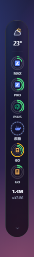
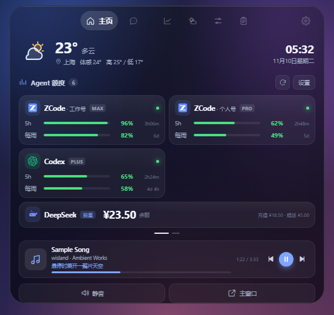
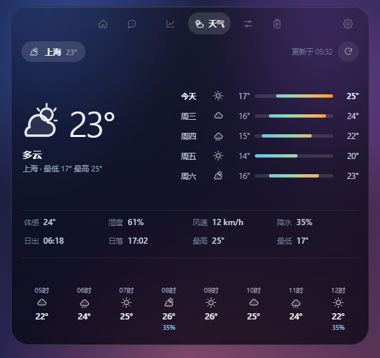
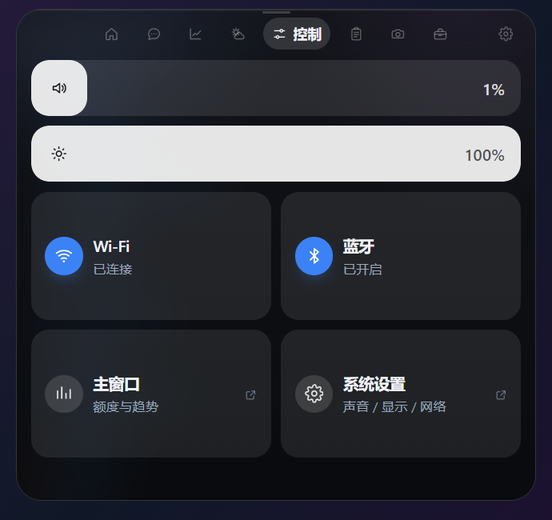
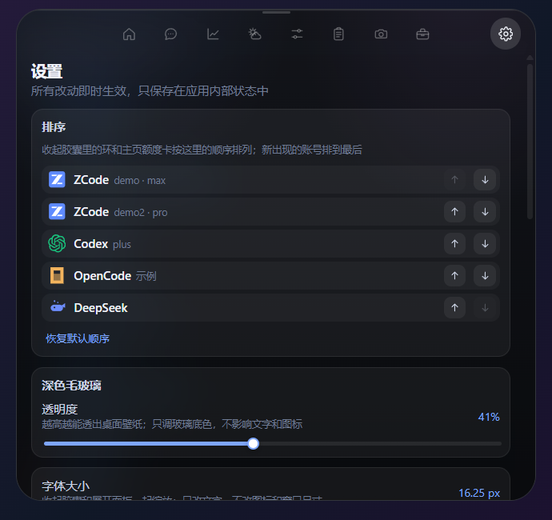
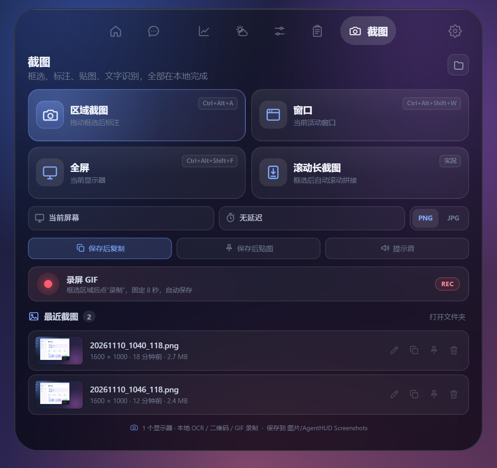
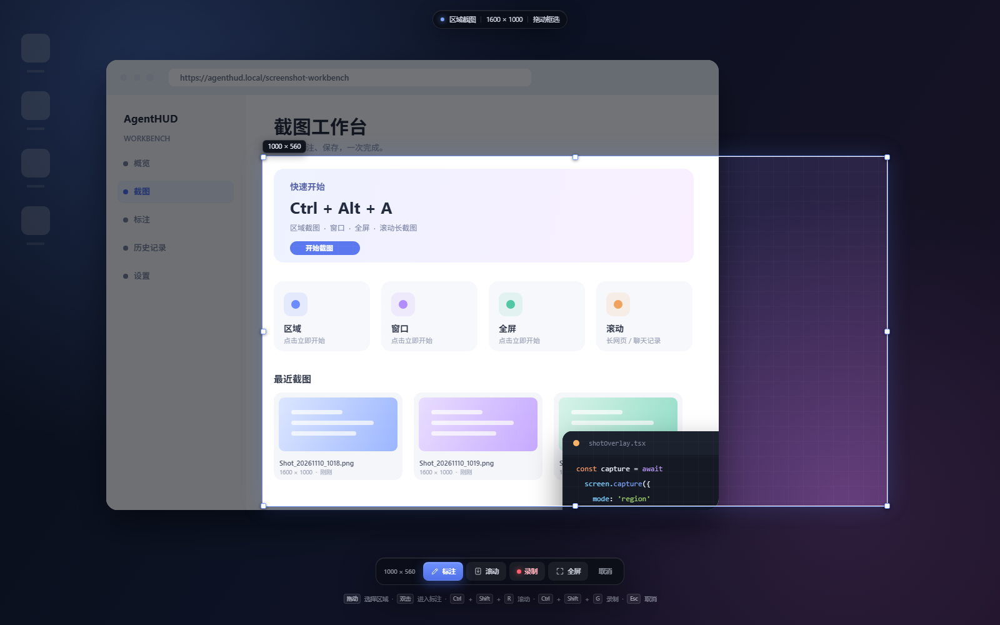
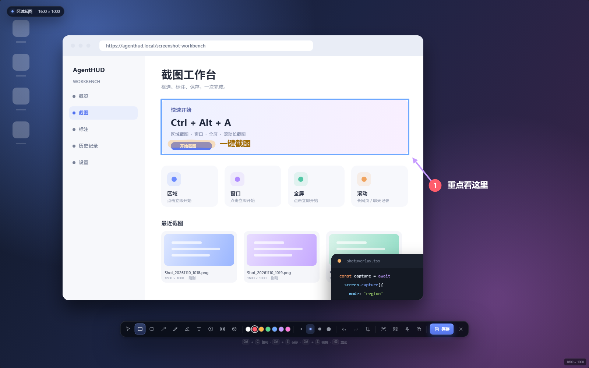

# 灵动岛 HUD（island）

顶部居中、悬浮在屏幕上缘的深色毛玻璃胶囊。视觉与交互参考
[Misaka273/wisland](https://github.com/Misaka273/wisland)（Windows 毛玻璃灵动岛，
MIT），实现为本项目自写的 Tauri + React 版本。收起态宽 500px、四角全部
圆角、顶部留 6px 呼吸位；悬停或点击后向两侧撑到 520px 并向下长成面板，像
一颗液体胶囊被拉开。拖拽时可吸附到屏幕上缘或左右边缘，贴左右边时收起态
变成 48×440 的竖胶囊。玻璃底层用 GDI 抓取岛身后的桌面缩略图，再由 CSS 高斯
模糊和深色染色合成，所以是真的“磨砂透出桌面”，不是单纯调低底色透明度。

> 明确的取舍：**不做宠物/表情**。默认收起态只显示 **Agent 额度 + 天气 +
> 今日 token/预估花费**，展开后才进入多页面板。旧版贴边停靠条（hud-bar）
> 仍保留代码，但首次启动会被自动关闭，由灵动岛接管 HUD 开关。当前版本保留
> 悬停展开与「长关」（关闭悬停展开，只能点击展开），不再提供常驻展开与鼠标
> 穿透；HUD 内也不含翻译页。配置不再暴露 JSON 文件，也没有“编辑配置”入口。

## 效果

| 收起态：额度 + 天气 + 今日用量 | 竖排：贴左右边 |
| --- | --- |
|  |  |

| 展开：主页 | 天气 | 控制 | 设置 |
| --- | --- | --- | --- |
|  |  |  |  |

| 截图工作台 | 区域选择 | 标注器 |
| --- | --- | --- |
|  |  |  |

## 使用

- **悬停**：停留约 220ms 后展开；**移出**：约 450ms 后收起，宽高一起弹簧式
  变化，内容等玻璃长到接近满高才淡入。热区按胶囊的**实际矩形**判定，不含窗口
  四周的透明留白，鼠标必须真正移到胶囊（竖排时是竖胶囊）上才会展开。
- **拖拽**：按住收起胶囊拖动；展开后**面板任意非表单区域**都能按住拖动（导航、卡片、
  空白都行，按钮/输入框/slider 保留原交互），移动超过 4px 会自动收成 552×70 的
  HUD 横条并放到光标下继续跟随，松手后再按最近的上/左/右边吸附。窗口用欠阻尼
  弹簧跟随系统光标（900 / 0.78，240Hz 子步进），快速甩动时有轻微滞后和回弹，
  本体按速度轻微拉伸。上边恢复横排，左右边变成竖排并贴边；位置和方向会记住，
  下次启动直接恢复。
- **多显示器**：拖拽范围是所有显示器工作区的并集，可拖到副屏（副屏在主屏左侧
  时窗口坐标会变成负数，也允许）。松手按窗口中心所在的那块屏吸附，并记住该
  显示器；之后悬停展开、重启都会留在同一块屏，不会跳回主屏。
- **竖排用量**：左右贴边时胶囊只有 48px 宽，token 自动压成 `1.11B` / `1091M`
  这类短写法，字号可放到 token 11px、花费 10.5px；百元级花费取整，超长值省略，
  不会撑出玻璃。
- **左右抽屉**：贴左/右边时，悬停展开固定对应边为锚点——左边向右推出、右边向左
  推出，内容从贴边方向滑入；移出时先反向滑回竖胶囊，再由窗口收窄回 70×520，不会
  整块往屏幕中间跳。
- **点击**：展开 / 收起；「长关」模式关闭悬停展开，只能点击胶囊展开。
- **滚轮**（收起态）：在「额度 + 天气 / 时钟 / 音乐」三种收起视图间切换。
- **主页额度分页**：每页 4 张卡；鼠标滚轮在额度区左右翻页，底部用白色细横条
  指示页码（不是数字），点击横条也可跳页。
- **右键**：原生风格菜单——展开收起、玻璃透明度、刷新、打开主窗口、关闭
  灵动岛、退出 AgentHUD。
- **齿轮**：设置页（深色毛玻璃透明度、字体大小、展开方式、全屏隐藏、三级
  天气位置 / 当前位置、股票阈值/刷新间隔、热键、打开主窗口 / 退出）。
- **全局热键**：默认 `Ctrl+Alt+Shift+I` 开关灵动岛（原 wisland 默认
  `Ctrl+Alt+I` 在本机常被输入法占用，故加了 Shift；可在设置页修改）。
- **截图热键**：`Ctrl+Alt+A` 区域、`Ctrl+Alt+Shift+W` 窗口、`Ctrl+Alt+Shift+F`
  全屏；截图器内 `Ctrl+C` 复制、`Ctrl+S` 保存、`Ctrl+P` 贴图、`Ctrl+Shift+O`
  OCR、`Ctrl+Shift+Q` 二维码、`Ctrl+Shift+R` 滚动、`Ctrl+Shift+G` 录 GIF。

## 已实现

| 模块 | 内容 |
| --- | --- |
| 收起态 | 天气图标/温度/城市 + **全部订阅的同心圆环**（同一来源的多账号/多凭证各占一枚，环下显示**订阅档位**：MAX / Pro / Plus / Go 等，按量余额型显示「余额」）：每圈一个真实窗口，外→内为 5h / 周 / 月，环长按已用比例、颜色按阈值分档；余额型画虚线圈，超出显示 `+N`。右侧显示**今日 token 合计 + 预估花费**（来自托盘标题线程同一份数据，不额外轮询；不再单独标「今日」二字，两行数字本身即今日口径） |
| 主页 | Agent 额度卡（5h/周/月窗口、套餐、余额、倒计时、账号名），每页 4 张、滚轮横滑、白色细横条页码；当前媒体/歌词、快捷操作、应用启动器 |
| 消息 | 只读 Windows 通知库 `wpndatabase.db`，映射 QQ / 微信 / 邮件 / 飞书 / 钉钉；未读徽标、筛选、全部已读、清空 |
| 股票 | 腾讯财经 A/港/美股行情、分时、搜索添加、删除、涨跌提醒（阈值可调） |
| 天气 | Open-Meteo（无需 Key）：城市胶囊、当前天气、8 项指标、5 天温度区间与逐小时（前 8 小时）；设置页用省/市/区县三级联动，支持按公网出口 IP“获取当前位置” |
| 控制 | 音量/静音（Windows Core Audio）、亮度（**DDC/CI 外接显示器优先**，失败回退 WMI 笔记本内屏；不再一律显示“不支持”）、Wi-Fi/蓝牙（WinRT Radio）；iOS 控制中心式粗滑块 + 2×2 磁贴 |
| 剪贴板 | 最近 10 条文本/图片，内存历史，点击写回剪贴板 |
| 截图 | 区域/窗口/全屏/延时截图、滚动长截图、标注器、贴图窗口、本地 OCR/二维码、8 秒 GIF 录制、PNG/JPG 保存、自动复制/贴图、历史打开/编辑/复制/贴图/删除。抓屏与编辑分离，截图页只做入口和历史；详见下方“截图工作台” |
| 媒体 | Windows SMTC：标题/歌手/封面/进度/播放状态 + 播放暂停/上一首/下一首 |
| 歌词 | 网易云公开接口按曲名+歌手取 LRC 与翻译；主页媒体条与收起音乐视图显示当前句 |
| 玻璃 | 固定深色毛玻璃，不再提供主题切换；右键菜单和设置页调“透明度”（0–90%）。越高越透出桌面，底图同时按比例压暗，保证白底上白字仍可读。**没有外投影**，透明窗口四周不再出现暗边 |
| 字体 | 设置页可选小 11.7 / 标准 13 / 大 14.3 / 特大 16.25px，也可直接输入 10–18px 自定义值（0.5px 步进、恢复默认）；只缩放文字，图标和窗口几何不变。收起胶囊、展开面板、右键菜单和提示一起生效，大字号时页面内容可滚动 |
| 窗口 | 透明、置顶、不抢启动焦点；支持上/左/右三边吸附，上边收起 500×48 / 展开 520×492，左右边收起 48×440 竖排 / 展开 520×492；全屏时自动隐藏；Windows 不使用系统 Acrylic 背板，玻璃只画在圆角形状内 |
| 配置 | 不再生成/暴露 `island.json`，也不再有“编辑配置”菜单；配置收进应用内部 SQLite 状态库，设置页是唯一入口 |
| 其它 | 全局热键、右键菜单、配置热更新、旧 HUD 与旧 JSON 配置自动迁移 |

## 截图工作台

截图页（标签栏最后的相机）与抓屏器、标注器分离：截图页只负责入口、最近截图
和设置；真正的框选/标注在覆盖当前显示器的 `shot.html` 窗口里完成。

- **区域截图**：`Ctrl+Alt+A`；拖动框选后可调整八个把手、移动选区，框选完成后可直接
  「复制」(`Ctrl+C`) 或「另存为…」(`Ctrl+S`)，也可以双击/回车进入标注。
- **窗口 / 全屏**：`Ctrl+Alt+Shift+W` / `Ctrl+Alt+Shift+F`；Windows 上窗口模式抓当前前台窗口
  （`PrintWindow`，失败回落屏幕裁剪），macOS 上调系统 `screencapture -w` 进入交互式选窗
  （鼠标悬停高亮、点击即抓，抓完直接进标注器）；全屏抓选定显示器。
- **延时**：0/3/5/10 秒，先隐藏 HUD 与自身窗口再抓屏。
- **滚动长截图**：框选后按 `Ctrl+Shift+R`（或点“滚动”），编辑器移出屏幕，向选区中心窗口发送真实滚轮消息，逐帧抓取并按行签名拼接；支持网页、聊天记录、文档等常规滚动容器。
- **标注器**：矩形/椭圆/箭头/画笔/高亮/文字/序号/马赛克/模糊，颜色与线宽、撤销重做、重新框选。
- **贴图**：`Ctrl+P`，把当前画面钉成无边框置顶窗口，可拖动、按比例缩放、复制、保存。
- **本地 OCR**：`Ctrl+Shift+O`，走 Windows.Media.Ocr，不联网；结果可直接复制。
- **二维码**：`Ctrl+Shift+Q`，本地 `rqrr` 解码，结果可复制。
- **GIF 录制**：选区后点“录制”或 `Ctrl+Shift+G`，固定 8 秒、最高 1000px 宽，保存到截图目录；结果弹窗可直接打开 GIF。
- **保存 / 复制**：默认 PNG（可切 JPG），保存到 `图片/AgentHUD Screenshots`；保存后可自动复制/贴图，历史列表支持打开、编辑标注、复制、贴图、二次确认删除。标注器里另有「另存为…」(`Ctrl+Shift+S`)，弹系统保存面板选任意目录。
- **历史编辑**：历史项铅笔按钮重新进入标注器，不是只能看外部文件。
- **无外部配置**：截图设置也在 `~/.agenthud/island.db` 内部状态库，不生成 JSON。
- **响应速度**：覆盖窗口在启动后预热并跨截图复用（只隐藏不销毁），抓屏只做一次
  `screencapture` 直出 PNG 交给 WebView，不再解码重编码。实测点击到可框选约
  0.35s（其中系统 `screencapture` 本身约 0.25s），后台会打印
  `[zbar-shot] 抓屏…/首帧已绘制…` 供排查。
- **多显示器**：截图页可选当前屏幕/指定显示器；区域与全屏按物理像素抓取，DPI 缩放由前端换算。

## 数据链路

- **额度**：复用 `hud_bar.rs` 的 `hud_bar` 数据线程与 `zbar://hud-bar-usage`
  事件，口径与主面板 Agent 表一致；灵动岛启动时补拉 `island_quota_snapshot`
  首帧。ZCode 多账号走 `accounts::account_quotas()`，provider（OpenCode Go /
  MiniMax 等）逐个凭证展开，不再只取第一条。
- **今日用量**：托盘标题线程每 30s 计算的同一份 token/花费缓存，经
  `zbar://island-today-usage` 推送；首帧补拉 `island_today_usage`，不额外跑库。
- **天气**：`island/weather.rs` 后台线程，立即取一拍后每 15 分钟刷新；
  `zbar://island-weather`。当前位置由 `island_locate` 查公网出口 IP。
- **股票**：`island/stocks.rs` 按配置间隔轮询（3–60s）；GBK 解码腾讯接口；
  `zbar://island-stocks` / `zbar://island-stock-alert`。
- **媒体**：`island/media.rs` 每 1.5s 读 SMTC；封面转 data URL；
  `zbar://island-media`。
- **系统**：`island/system.rs` 每 1.8s 读音量、每 5s 读无线电、每 10s 回读
  已支持的 DDC/CI 亮度；只在变化时广播。
- **剪贴板**：`island/clipboard.rs` 每 0.8s 轮询 arboard；`zbar://island-clipboard`。
- **消息**：`island/notify.rs` 只读通知数据库，每 2s 增量读取；
  `zbar://island-notify`。
- **歌词**：按需命令，不后台轮询。
- **拖拽**：Rust 侧读系统光标，按 900 / 0.78 欠阻尼弹簧（240Hz 子步进）移动
  窗口；前端约 60fps 驱动并用每帧位移做速度形变。松手后 `island_drag_end`
  选择最近边、落盘 `edge/posFrac` 并切换横竖窗口。
- **截图**：`island/screenshot.rs` 用 GDI `BitBlt` / `PrintWindow` 抓屏，
  PNG 原始字节走 `shot_session_image` raw IPC（不塞 base64 会话）；滚动截图
  用 `PostMessage(WM_MOUSEWHEEL)` + 真实输入补发，按行签名搜索重叠区拼接；
  OCR 用 WinRT `Windows.Media.Ocr`；二维码用 `rqrr`；GIF 用 `gif` crate。
  截图设置存在 `island.db` 的 `shot_settings` 表。

所有后台线程都有 generation 计数：关闭灵动岛时旧线程退出，重新开启不会
叠加重复轮询。

## 文件

```
island.html                       # Vite 入口
src/island-main.tsx               # React 挂载 + 浏览器预览桌面
src/island/IslandApp.tsx          # 窗口壳：收起/展开/导航/拖拽/右键菜单/事件桥
src/island/pages.tsx              # 主页 / 消息 / 股票 / 天气 / 控制 / 剪贴板 / 设置
src/island/ShotPage.tsx           # 截图页：入口、显示器/延时、最近截图、录屏入口
src/island/china.ts               # 省/市/区县三级索引
src/island/data/china-pca.json    # 三级行政区数据（MIT，cn-division）src/island/ui.tsx                 # 图标、天气图形、品牌、额度条、歌词解析
src/island/api.ts                 # invoke/事件封装 + 浏览器 mock 回退
src/island/types.ts               # 前后端数据契约
src/island/island.css             # 深色玻璃、圆环、横竖排、页面、拖拽形变
src-tauri/src/island/mod.rs       # 窗口/配置/展开收起/拖拽吸附/全屏/命令
src-tauri/src/island/store.rs     # 内部 SQLite 配置库 + 旧 JSON 迁移
src-tauri/src/island/backdrop.rs  # 桌面缩略图抓取（WDA 排除自身 + GDI + PNG）
src-tauri/src/island/screenshot.rs # 抓屏/选区窗口/滚动拼接/OCR/二维码/贴图/GIF
src-tauri/src/island/{weather,stocks,media,system,clipboard,notify,lyrics}.rs
shot.html / src/shot/             # 全屏框选 + 标注器（shot.css / api / mock）
pin.html / src/pin/               # 贴图窗口
src-tauri/capabilities/island.json
src-tauri/capabilities/shot.json
src-tauri/capabilities/pin.json
```

## 配置

配置不再落在 `~/.agenthud/island.json`，也没有右键“编辑配置”。旧版 JSON 在
首次启动时自动迁移进应用内部 SQLite（`~/.agenthud/island.db`，单行状态），
迁移成功后删除旧文件；之后只在设置页修改，前端不再暴露原始配置。

| 字段 | 说明 |
| --- | --- |
| `enabled` | 灵动岛总开关（默认 true） |
| `transparency` | 深色玻璃透明度，0–90；默认 40。越高越透出桌面，同时底图会变暗 |
| `fontSize` | 界面基准字号（逻辑 px），10–18；默认 13。只缩放文字，不缩放图标或窗口 |
| `expandMode` | `hover`（悬停展开）/ `never`（长关，关闭悬停展开）；不再支持 `always` |
| `compactView` | `quota` / `clock` / `music` |
| `replaceLegacyBar` | 首次启动关闭旧贴边 HUD（默认 true） |
| `weatherCity` / `weatherLabel` / `weatherLat` / `weatherLon` | 天气查询城市、展示名与坐标；改城市时清空经纬度自动重定位 |
| `edge` / `posFrac` | 吸附边（top/left/right）与沿边位置，拖拽后自动更新 |
| `monitor` | 上次吸附的显示器设备名（如 `\\.\DISPLAY2`）；为空或该屏不存在时回退主屏 |
| `stocks` / `stockIntervalSec` / `stockAlertPct` | 自选股、刷新秒数、提醒阈值；允许删空，代码比较忽略大小写（`usAAPL` / `usaapl`） |
| `hotkeyToggle` | 全局开关热键，如 `Ctrl+Alt+Shift+I` |
| `hideFullscreen` | 全屏时隐藏 |
| `hiddenTabs` | 隐藏的板块（`msg`/`stock`/`weather`/`ctl`/`clip`/`shot`） |
| `launcher` | 主页启动器条目（名字 / 路径 / 图标键） |

## 暂未移植

以下 wisland 功能依赖较大的本地模型或第三方客户端，未在本轮实现；如需要
可继续加：

- **实时字幕 / 日语 ASR**：需要约 630MB 本地模型（Parakeet / VAD / 翻译
  流水线），本轮只做 HUD 本身，不含系统声音采集与识别。
- **单词本 / AnkiConnect 同步**：HUD 不提供翻译/生词本页面。
- **Clash Verge 控制**：未接 external-controller / 命名管道。
- **Thunderbird IMAP 未读**：消息页目前只读 Windows 系统通知（Outlook /
  新版邮件 / QQ / 微信 / 飞书 / 钉钉等）。
- **任务栏闪烁检测**：只读通知库，不挂 Win32 事件钩子。
- **底部吸附**：目前只吸上/左/右三边，避免与任务栏重叠。
- **跨平台抓屏**：Windows 走 GDI `BitBlt`/`PrintWindow`；macOS 走系统
  `/usr/sbin/screencapture`（首次使用需在「系统设置 → 隐私与安全性 → 屏幕录制」
  里授予 AgentHUD 权限，否则会给出明确提示）。macOS 的滚动长截图尚未实现，
  框选工具条里不会出现「滚动」。
- **跨平台桌面模糊**：抓屏采样目前仅 Windows；macOS 上退化为纯 CSS 深色玻璃。
- **视频录屏 / 麦克风 / 系统音频**：截图页目前提供 8 秒 GIF 录制；MP4/WebM、
  音频混流和录制控制条尚未接入。
- **云翻译 / 表格识别 / AI 图片转换**：本地 OCR 与二维码已实现；需要外部
  服务或大模型的图片翻译、表格结构化、AI 重写暂未接入。
- **贴图跨重启恢复**：贴图窗口在当前运行期有效，退出后不自动恢复。
- **跨显示器一次框选**：一次截图只覆盖一个显示器；跨屏框选未实现。
