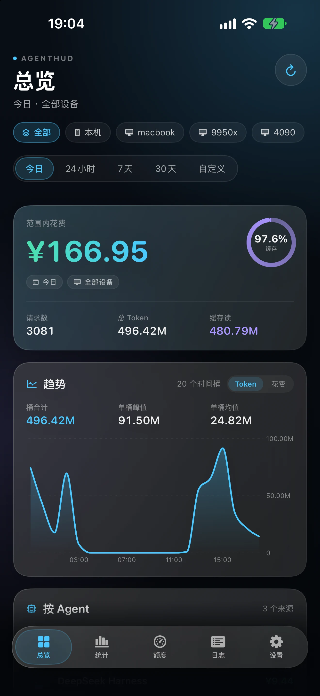
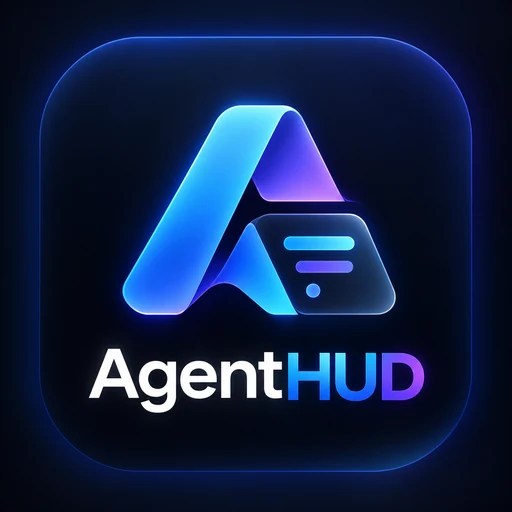
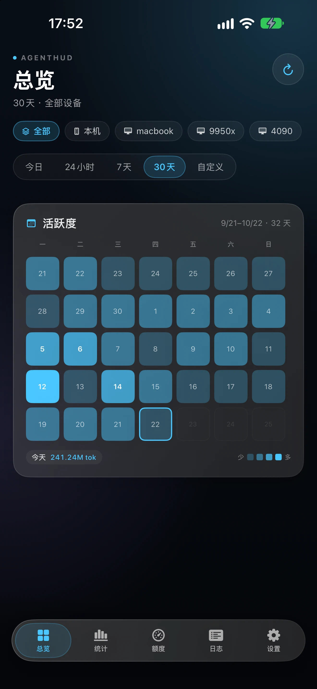
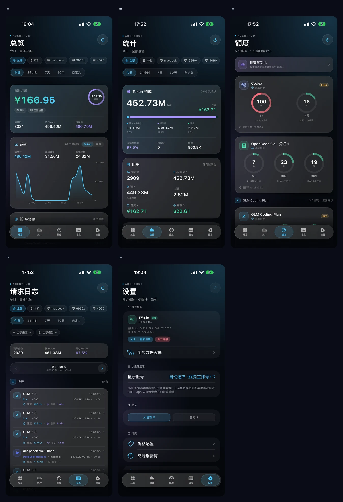
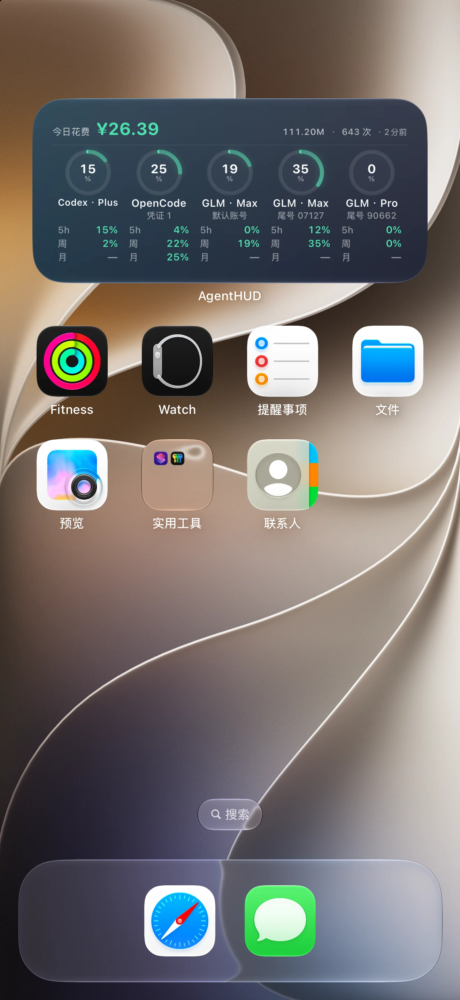

# AgentHUD · iOS 版（App + 小组件）

桌面版 ZBar（Tauri）的 iOS 配套应用。复用同一个自托管同步服务（`server/`），把 iPhone 当作一台新设备注册，在手机上查看今日花费 / Token / 额度，并通过锁屏 & 主屏小组件快速一览。

> **零后端改动**：iOS 端不新增任何服务端接口，直接调用 `server/app.py` 现有的 `/register`、`/usage`、`/snapshots`、`/period_detail`、`/devices`。用量与额度都由桌面端同步上传，iOS 只读展示。

---

## 目录结构

```
ios/
├── agenthud/
│   ├── agenthud.xcodeproj/         # Xcode 工程文件
│   └── agenthud/                   # 主 App 源码
│       ├── AgentHUDApp.swift       # @main 入口 / 自绘悬浮 Tab 栏
│       ├── Assets.xcassets     # AppIcon（桌面端 logo）+ 各 Agent 品牌图标
│       ├── Models/             # Types.swift + PricingDefaults.json（内置价格表）
│       ├── Core/               # API 客户端 / 计费 / 折算 / 格式化 / 配置 / 数据加载
│       └── Views/              # 总览 / 统计 / 额度 / 日志 / 设置 五个 Tab
│           ├── DesignSystem.swift  # 配色 / 背景 / 玻璃卡片 / 页头 / 进度环等
│           ├── OverviewView.swift  # 总览（范围汇总 + 趋势 + Agent + 活跃度日历）
│           ├── StatsView.swift     # 统计（Token 构成 + 明细 + 按模型）
│           ├── QuotaView.swift     # 额度（按 Agent 分组的账号卡 + 进度环）
│           ├── LogsView.swift      # 请求日志（分页 + 速度/首字 + 详情 sheet）
│           └── SettingsView.swift  # 设置 / 小组件 / 计费 / 关于
└── agenthudWidget/                 # Widget Extension 源码
    ├── AgentHUDWidget.swift        # WidgetBundle（主屏 + 锁屏）
    ├── WidgetViews.swift       # 小/中尺寸 + 锁屏三个 family 的视图
    └── WidgetShared.swift      # ⚠️ 只编译进 Widget target 的类型定义
```

---

## 界面与视觉

- 统一视觉体系在 `Views/DesignSystem.swift`：深空渐变背景 + 玻璃卡片 + 青蓝主色；
  金额用 mint、缓存 / 次级数据用 violet、额度超限用 coral。
- 根容器使用自绘悬浮 Tab 栏（`HUDFloatingTabBar`），与卡片风格一致，并带
  iOS 26/27 玻璃材质。Tab 首次点开才创建，切回时保留各页滚动位置与数据。
- 各 Tab 首页统一用 `PageHeader`（品牌小标 + 大标题 + 副标题 + 圆形刷新按钮），
  替代系统导航栏标题；日志 / 额度 / 统计页的筛选与范围选择也复用了胶囊 chip。
- 趋势与额度对比图统一为无网格干扰的「面积 + 折线 / 圆角柱」；X 轴最多 5 个
  刻度，长区间不会出现日期叠字。
- 总览默认「今日」（与小组件口径一致），「活跃度」改成近 5 周日历：格子内直接显示日期数字，今天/选中日有描边，
  点任意一天在底部查看当天 Token；不再用 13 周密集小格。
- App Icon 复用桌面端 `src-tauri/icons/ios/AppIcon-512@2x.png`；额度 / 日志 /
  统计里的 Agent 图标复用桌面端同款品牌 mark（OpenAI / Anthropic / Cursor /
  Kimi / DeepSeek / OpenCode / MiniMax / GLM 等），见 `Assets.xcassets`。
- 请求日志改为每页 50 条的分页（上一页 / 下一页），不再无限追加；行内补上
  输出速度（无首字时用 ≈ 标注整请求平均）与首字延迟，数据缺失显示「—」。
- 免费版 Cursor 且所有窗口均为 0% 时不出卡（错误态/有余额的仍保留）。









---

## 开发环境

- **macOS 14+**（Xcode 15+）
- **iOS 17.0+** 真机（用到了 iOS 17 的 SwiftUI 新 API：`onChange` 双参数签名、Widget `containerBackground`）
- **不需要 Apple 开发者账号**，用 Xcode 自带的免费 Personal Team 即可（自用、7 天签名）

---

## 方式一：直接打开工程（首选）

```bash
open ios/agenthud/agenthud.xcodeproj
```

打开后：

1. 顶部选择目标设备（你的 iPhone 真机）。
2. 左侧选 `agenthud` 项目 → **Signing & Capabilities**：
   - `Team`：选你的 **Personal Team**（标 "Personal Team" 的那项）。
   - `Bundle Identifier`：保持 `com.chacca.agenthud`，**不要改**（改了 App Group 要跟着改）。
3. 对 `agenthudWidget` target 做同样操作。
4. 数据线连 iPhone → 点 **Run**（▶）。
5. 首次运行后 iPhone 会提示「不受信任的开发者」→ 去 **设置 → 通用 → VPN与设备管理** → 信任你的开发者证书。

> 如果工程打不开（报 "Project format is too old / 无法读取"），直接用下面的**方式二**，最稳。

---

## 方式二：手动新建工程（100% 可靠，兜底方案）

工程文件（`.xcodeproj`）格式在不同 Xcode 版本之间有差异。如果方式一失败，按下面重建：

### 1. 新建主 App

1. Xcode → **File → New → Project** → **iOS / App** → Next。
2. 填写：
   - Product Name：`agenthud`
   - Organization Identifier：`com.chacca`
   - Interface：**SwiftUI**
   - Language：**Swift**
   - 取消勾选 "Include Tests"（不需要）
   - 保存到 `ios/` 目录下（会提示覆盖，选覆盖或新建 `agenthud2` 后把源码挪过去）
3. 删除 Xcode 自动生成的 `ContentView.swift`、`AgentHUDApp.swift`、`Assets.xcassets/AccentColor` 等占位文件。

### 2. 拖入主 App 源码

把 `ios/agenthud/agenthud/` 下的所有文件拖进 Xcode 的 `agenthud` 组里：

- 勾选 **Copy items if needed** ✅
- 勾选 **Add to targets: agenthud** ✅（不要勾 agenthudWidget）
- 包括 `Models/`、`Core/`、`Views/` 三个文件夹，以及 `AgentHUDApp.swift`、`Info.plist`、`agenthud.entitlements`、`PricingDefaults.json`

### 3. 新建 Widget Extension

1. 选中 `agenthud` 项目 → **File → New → Target** → **iOS / Widget Extension** → Next。
2. 填写：
   - Product Name：`agenthudWidget`
   - 取消勾选 "Include Configuration App Intent"（不需要）
3. 删除 Xcode 自动生成的 `AgentHUDWidget.swift` 等占位文件。
4. 把 `ios/agenthudWidget/` 下的 `AgentHUDWidget.swift`、`WidgetViews.swift`、`WidgetShared.swift`、`agenthudWidget.entitlements` 拖进 `agenthudWidget` 组：
   - 勾选 **Add to targets: agenthudWidget** ✅（不要勾 agenthud）

### 4. 配置 App Group（关键！）

两个 target 都要配同一个 App Group，否则 Widget 读不到 App 写的数据：

**对 `agenthud` target**：
1. **Signing & Capabilities → + Capability → App Groups**。
2. 点 **+**，添加：`group.com.chacca.agenthud`

**对 `agenthudWidget` target**：重复上面两步，加同一个 group。

### 5. 配置 ATS（允许 HTTP）

如果工程新建后没自动继承，手动在主 App 的 `Info.plist` 加：

```xml
<key>NSAppTransportSecurity</key>
<dict>
    <key>NSAllowsArbitraryLoads</key>
    <true/>
</dict>
```

（自托管服务可能是裸 HTTP，不加这个会连不上）

### 6. 签名 & 运行

两个 target 的 **Signing** 都选 **Personal Team** → Run。

---

## 首次使用：连接同步服务

App 装上后：

1. 打开 App → 底部 **设置** Tab。
2. **同步服务 → 连接同步服务…**：
   - **服务器**：你部署 `server/` 的地址，如 `http://192.168.1.100:3838`
   - **Master Token**：`server/` 启动时打印的 Master Token（或 `cat zbar-data/master.token`）
   - **设备名**：填 `iPhone` 或任意名字
   - 点 **连接并注册**
3. 回到 **统计** / **额度** / **日志** Tab 即可看到数据。

> 额度账号不需要在 iOS 手动添加：在桌面端登录 / 切换账号，桌面端会通过同一个同步服务上传额度快照，iOS 额度页自动展示。

> 注册成功后，iPhone 会作为一台新设备出现在桌面版 ZBar 的「设备筛选器」里，多设备汇总自动生效。

---

## 添加桌面小组件

1. 在 iPhone 主屏长按空白处 → 进入编辑模式 → 点左上角 **+**。
2. 搜索 **AgentHUD**。
3. 选择尺寸：
   - **小**（2×2）：今日花费 + Token + 额度进度条
   - **中**（4×2）：左侧大数字 + 右侧三档额度详情 + 重置倒计时
4. 点 **添加小组件**。
5. 想切换小组件展示的账号：App → **设置 → 小组件显示 → 显示账号**；切换后回桌面即可（App 内刷新会主动重绘 Widget）。

锁屏小组件（iOS 17+）：
1. 锁屏长按 → 自定义 → 添加小组件 → 找到 AgentHUD。
2. 三种形态：
   - **长条**（Rectangular）：花费 + 周/5h 百分比
   - **圆形**（Circular）：weekly 百分比环形
   - **顶部行**（Inline）：一行文字 "AgentHUD ¥12.34 · 3.7M"

---

## 小组件刷新说明（重要限制）

iOS Widget **不能像桌面端那样 30 秒刷新一次**。系统限制：

- 后台由系统调度，通常 **15~40 分钟** 刷新一次，且系统会根据电量、使用频率降频。
- App 每次刷新会写入 App Group，并调用 `WidgetCenter.reloadAllTimelines()` 主动重绘，所以前台刷新后回桌面通常能立刻看到新数据。
- 小组件使用 `StaticConfiguration`（不再依赖 AppIntent 配置），账号切换统一在 App 设置里完成，避免部分真机上小组件只显示占位图的问题。



---

## 免费账号（Personal Team）的限制

| 限制 | 说明 |
|---|---|
| **7 天签名** | 过期后 App 打不开，需重新连 Mac 跑一次 Xcode（数据不丢，存在 UserDefaults / App Group） |
| **3 个 App ID/周** | 反复删除重建 Bundle ID 会占用配额 |
| **无推送** | 不能用远程推送触发 Widget 刷新 |
| **Widget 随 App 签名** | Widget 不能单独安装 |

自己用完全没问题，只是每周插一次数据线。

---

## 数据流（一图看懂）

```
┌─────────────┐   /usage /snapshots    ┌──────────────┐
│ 你的 server  │◄──────────────────────│  AgentHUD iOS App │
│  (Flask)     │   /period_detail       │  (主进程)      │
└─────────────┘   /register /devices    └──────┬───────┘
                                                │ 写 App Group
                                                ▼
┌─────────────┐   /snapshots           ┌──────────────┐
│ 你的 server  │◄──────────────────────│ Widget 读取    │
│ (额度快照)    │                       │ (只读 App Group)│
└─────────────┘                       └──────────────┘
```

- **用量统计**：iOS App → 你的 server（Device Token 鉴权）
- **额度监控**：桌面端 → 你的 server（额度快照）；iOS App → 你的 server 拉取快照
- **Widget**：不联网，只读 App 写入的 App Group 缓存（`StaticConfiguration`）

---

## 计费逻辑（与桌面端 1:1）

iOS 端复刻了桌面版的核心计算（`src/merge.ts`、`src/peak.ts`、`src/format.ts`）：

| 文件 | 对应桌面端 | 说明 |
|---|---|---|
| `Core/Billing.swift` | `merge.ts` | `modelCost`：非缓存输入 = input − cache_read，避免重复计费 |
| `Core/Peak.swift` | `peak.ts` | V2/V3 高峰期倍率折算 + ZCode 0.67 优惠 |
| `Core/Format.swift` | `format.ts` | Token/金额/百分比/倒计时格式化 |
| `Core/PeriodParser.swift` | `quota_history.rs` | 按 `weekly_reset` 跳变切分重置周期 |
| `Models/PricingDefaults.json` | `public/pricing-defaults.json` | 内置参考价格表（仅在桌面端价格未同步时兜底） |

### 价格来源：桌面端统一维护，手机端只读

手机端不再提供模型价格编辑，价格以**服务端全局表**为准：任意桌面端保存后按模型增量推送（带 `base_revision`），服务端合并并递增 revision，其他桌面端下一轮同步拉取整表，手机端每次刷新通过 `GET /pricing` 拉取缓存。

- 不同桌面端改不同模型互不覆盖；同一模型以服务端最后接收的写入为准，客户端会提示已与其他设备合并；
- App 用 `usd × fx_rate` 实时折算 CNY，汇率也随价格表下发，保证各端花费口径一致；
- **未使用服务端时**：桌面端只读写本机 `pricing.json`，价格编辑/计费完全本地，不产生网络请求；iOS 不显示远端价格，也不会因此报错；
- 服务端不可达/未升级（无 `/pricing`）或桌面端尚未同步时，App 自动回退上次缓存或 `PricingDefaults.json` 本地参考价；
- 设置 → 模型价格 只展示模型单价、汇率、同步时间，并提供「立即同步」；不支持新增/编辑/删除。

部署顺序：先更新服务端（`server/app.py`，无表结构迁移）→ 桌面端新版并完成一次同步 → iOS 端。服务端未升级时 iOS 会提示「同步服务尚未升级」，继续使用本地价格表，不影响用量/额度。


---

## 已知限制 / TODO

- [ ] 高峰期时段（Peak Segment）目前 iOS 端只支持开关和订阅类型切换，不支持可视化编辑时段（沿用默认或桌面端配置）。如需自定义时段，建议在桌面端配好后保持默认。
- [ ] 小组件后台无主动拉数据，后台刷新仍由系统调度；App 前台刷新会立即重绘。
- [ ] 未实现 Background Tasks（`BGAppRefreshTask`）后台预拉——可作为后续优化，提升 Widget 数据新鲜度。
- [ ] 暂无独立的"用量报告"页面（桌面版的 ReportPanel），统计 Tab 已覆盖主要信息。

---

## 故障排查

**小组件显示"待同步 / 空数据"**
- 小组件现在会在没有快照时显示「打开 App 同步数据」，这是正常提示，不是加载失败。
- 打开 App 成功连上 server 后，点一次「立即刷新全部数据」，App 会写入 App Group 并主动重绘 Widget。
- 确认 **agenthud** 和 **agenthudWidget** 两个 target 的 Signing & Capabilities 都启用了同一个 App Group `group.com.chacca.agenthud`。
- 如果之前加过旧版小组件，删掉重新添加一次（旧配置可能还停留在 AppIntent 版本）。

**连不上 server（连接超时）**
- 确认 iPhone 和 server 在同一网络，或 server 有公网 IP。
- 确认 server 防火墙/安全组放行了端口（默认 3838）。
- 确认 ATS 已允许 HTTP（见上文）。
- 在 iPhone Safari 访问 `http://你的IP:3838/health`，应返回 `ok`。

**额度页没有数据**
- 确认桌面端已登录额度账号，并且和 iPhone 指向同一个同步服务。
- 在桌面端额度页手动刷新一次，等待快照上传；iOS 额度页下拉刷新。
- 本版本不再在 iOS 设置里手动添加额度账号。

**签名 7 天后失效**
- 重新用数据线连 Mac，在 Xcode 点 Run 即可续签（数据保留）。
